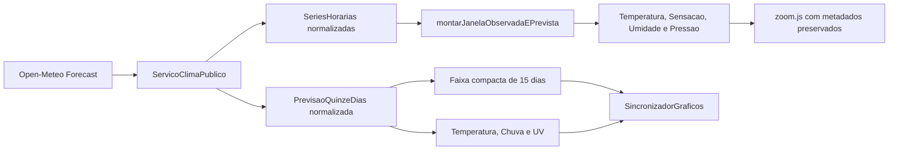
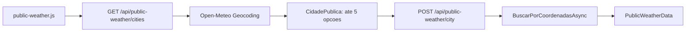

# ARCHITECTURE_AI

Base de conhecimento para IA baseada nos arquivos-fonte atuais do projeto `EstacaoClimatica`.

## Visao Geral

O sistema e um dashboard web de estacao climatica. Ele oferece consulta publica por CEP, cidade brasileira ou localizacao do navegador e exibe a aba global Estação, dados de Sala, Quarto, Aquario e eventos solares centralizados na Estação. A aplicacao ativa e uma solucao C#/.NET 8 com ASP.NET Core Controllers, uma camada de aplicacao com regras de montagem de dashboard, uma camada de infraestrutura que le Firebase Realtime Database via REST e um frontend estatico em HTML/CSS/JavaScript.

Usuarios inferidos pelo codigo: qualquer usuario que abre a pagina web e consulta dados por data.

Problema resolvido pelo codigo: consolidar registros do Firebase em uma resposta JSON processada e renderizar metricas, graficos, tabelas, heatmaps, aba Estação, informacoes solares, indicadores contextuais no header, navegacao por toque, exportacao PDF/JSON da aba ativa e assistente climatico via backend C#.

## Convencao de Nomenclatura

Codigo interno novo ou refatorado deve usar nomes em PT-BR para metodos, funcoes e variaveis, acompanhando o dominio da aplicacao. Devem permanecer com o nome original apenas os campos Firebase, ids/classes DOM, contratos JSON ou HTTP publicos, propriedades exigidas por APIs externas ou bibliotecas e chaves estruturais ja consumidas por outros modulos.

Fluxo principal:

1. `src/EstacaoClimatica.Web/Program.cs` inicia ASP.NET Core.
2. O navegador recebe `index.html`, `style.css` e `app.js` de `wwwroot`.
3. `app.js` calcula uma data padrao no formato `dd-MM-yyyy` e chama `GET /api/dashboard?date=...`.
4. `DashboardController` chama `IServicoDashboardClimatico.ObterDashboardAsync`.
5. `ServicoDashboardClimatico` solicita dados brutos ao `IRepositorioDadosClimaticos`.
6. `RepositorioDadosClimaticosFirebase` le quatro caminhos do Firebase por `IFonteDadosFirebase`.
7. Builders de aplicacao montam estatisticas, graficos, tabelas, heatmaps e solar.
8. A API retorna `DashboardResponse`.
9. `app.js` orquestra o frontend e `scripts/*` renderiza cards, Chart.js, tabelas, heatmaps, indicador astronomico, zoom, mensagens de estado, navegacao touch e exportacao PDF/JSON.

## Estrutura Fisica

```text
EstacaoClimatica.sln
README.md
src/
  EstacaoClimatica.Domain/
    DashboardModels.cs
    EstacaoClimatica.Domain.csproj
  EstacaoClimatica.Application/
    Abstractions/
      IClimateDashboardService.cs
      IClimateChatService.cs
      IClimateDataRepository.cs
      IFirebaseDataSource.cs
      ITextGenerationClient.cs
    Builders/
      ChartSeriesBuilder.cs
      EnvironmentDashboardBuilder.cs
      HeatmapBuilder.cs
      SolarDashboardBuilder.cs
      StatsBuilder.cs
      TableDataBuilder.cs
    Configuration/
      AiOptions.cs
      AppColors.cs
      FirebaseOptions.cs
    Models/
      ChartDefinition.cs
      ClimateRecord.cs
      FirebaseRecord.cs
      MetricDefinition.cs
      SolarEventSeconds.cs
    Services/
      ClimateChatService.cs
      ClimateDashboardService.cs
      FirebaseDashboardData.cs
    Utilities/
      FirebaseDate.cs
      FirebaseRecordReader.cs
      JsonNumberReader.cs
    EstacaoClimatica.Application.csproj
  EstacaoClimatica.Infrastructure/
    Firebase/
      FirebaseDataSource.cs
    Repositories/
      FirebaseClimateDataRepository.cs
    EstacaoClimatica.Infrastructure.csproj
  EstacaoClimatica.Web/
    Controllers/
      ChatController.cs
      DashboardController.cs
    Program.cs
    appsettings.json
    appsettings.Development.json
    Properties/launchSettings.json
    wwwroot/
      app.js
      index.html
      pdf-report.css
      style.css
      scripts/
        config.js
        heatmaps.js
        moon.js
        pdf-report.js
        season.js
        solar.js
        ui.js
        utils.js
        zoom.js
        chat.js
        views/
          dashboard-view.js
          station-view.js
      vendor/
        chart.umd.min.js
        html2canvas.min.js
        jspdf.umd.min.js
    EstacaoClimatica.Web.csproj
tests/
  EstacaoClimatica.Tests/
    ClimateChatServiceTests.cs
    ClimateDashboardServiceTests.cs
    FrontendStructureTests.cs
    FrontendBrowserTests.cs
    EstacaoClimatica.Tests.csproj
```

`bin/` e `obj/` existem como artefatos de build e nao devem ser tratados como codigo-fonte.

## Projetos .NET

`EstacaoClimatica.Domain`: contem records serializados pela API.

`EstacaoClimatica.Application`: contem abstracoes, configuracoes, modelos internos, utilitarios, builders e servico de orquestracao.

`EstacaoClimatica.Infrastructure`: contem implementacao HTTP para Firebase.

`EstacaoClimatica.Web`: contem ASP.NET Core Controllers e frontend estatico.

`EstacaoClimatica.Tests`: contem testes xUnit para regras principais do servico.

## Fluxo de Execucao

Inicializacao:

`Program.cs` registra:

- `OpcoesFirebase` como singleton a partir de `Firebase`.
- `CoresAplicacao` como singleton a partir de `Colors`.
- `OpcoesIa` como singleton a partir de `ArtificialIntelligence` para configurar IA/App Check sem expor segredo no frontend.
- `IServicoDashboardClimatico` -> `ServicoDashboardClimatico` como scoped.
- `IServicoAssistenteClimatico` -> `ServicoAssistenteClimatico` como scoped.
- `IRepositorioDadosClimaticos` -> `RepositorioDadosClimaticosFirebase` como scoped.
- `IFonteDadosFirebase` -> `FonteDadosFirebase` via `AddHttpClient`.
- `IClienteGeracaoTexto` -> `ClienteGeracaoTextoGemini` via `AddHttpClient`.

Middleware:

- `UseDefaultFiles()`
- `UseStaticFiles()`

Endpoints:

- `GET /api/dashboard`
- `POST /api/chat`
- `GET /api/health`

## Componentes

### Program.cs

Responsabilidade: configurar DI, controllers e arquivos estaticos.

Entradas: configuracao ASP.NET.

Saidas: arquivos estaticos e controllers mapeados.

Dependencias: `IServicoDashboardClimatico`, `IRepositorioDadosClimaticos`, `FonteDadosFirebase`, `OpcoesFirebase`, `CoresAplicacao`, `OpcoesIa`.

### DashboardController.cs

Responsabilidade: expor as rotas HTTP publicas da API.

Entradas: query string `date`, `CancellationToken`.

Saidas: JSON de dashboard e JSON de health.

Dependencias: `IServicoDashboardClimatico`.

Rotas:

- `GET /api/dashboard`
- `GET /api/health`

### ChatController.cs

Responsabilidade: expor `POST /api/chat` para o assistente climatico.

Entradas: `ChatRequest` com pergunta, aba ativa e data selecionada.

Saidas: `ChatResponse`.

Dependencias: `IServicoAssistenteClimatico`.

### ClimateChatService.cs

Responsabilidade: interpretar perguntas, calcular respostas com dados locais e usar IA opcional apenas para classificar/redigir.

Comportamento:

- usa a aba ativa quando o ambiente nao aparece na pergunta;
- usa a data selecionada quando o periodo nao aparece na pergunta;
- aceita metricas por nomes e aliases, incluindo Tolueno/Toluen;
- redireciona AQI/IAQ/qualidade do ar e gases MQ135 para Sala;
- calcula AQI estimado com os gases da Sala/MQ135 e as mesmas faixas do indicador do header;
- aceita hora especifica, faixa horaria, ultimas 24h reais e status de faixa de conforto;
- aceita memoria curta de conversa via `PreviousIntent`, herdando ambiente, metrica, operacao, hora e faixa horaria em perguntas de continuidade;
- converte valor atual/agora/ultima medicao e perguntas simples `qual o/a <metrica>` em consulta da ultima amostra disponivel no recorte;
- responde analise por horario e consultas equivalentes aos heatmaps;
- responde ciclo solar, duracao do dia e comparacoes/tendencias solares;
- com `ArtificialIntelligence:Enabled=false`, responde localmente;
- com IA habilitada, envia apenas resultado calculado para redacao.

### ClimateDashboardService.cs

Responsabilidade: normalizar data e montar `DashboardResponse`.

Entradas: `dataFirebase`, `CancellationToken`.

Saidas: `DashboardResponse`.

Dependencias diretas: `IRepositorioDadosClimaticos`, `MontadorDashboardAmbiente`, `MontadorDashboardSolar`, `DataFirebase`.

Comportamento:

- Data vazia vira `DateTime.Today` em `dd-MM-yyyy`.
- Dados brutos sao carregados por `IRepositorioDadosClimaticos`.
- Sala, Quarto e Aquario sao montados por `MontadorDashboardAmbiente`.
- Solar e montado por `MontadorDashboardSolar`.

### FirebaseClimateDataRepository.cs

Responsabilidade: carregar os quatro ramos Firebase necessarios para montar o dashboard.

Entrada: `CancellationToken`.

Saida: `DadosDashboardFirebase`.

Dependencias: `IFonteDadosFirebase`, `OpcoesFirebase`.

Comportamento:

- Le Room, Solar, Aquarium e LivingRoom em paralelo.
- Retorna os quatro `JsonElement?` brutos para a camada Application montar o dashboard.

### FirebaseDataSource.cs

Responsabilidade: buscar um caminho do Firebase Realtime Database usando REST.

Entrada: caminho configurado.

Saida: `JsonElement?` clonado ou `null` se o JSON raiz for null.

Dependencias: `HttpClient`, `OpcoesFirebase`.

Comportamento:

- Exige `Firebase:DatabaseUrl`.
- Monta URL como `{DatabaseUrl}/{caminho}.json`.
- Codifica espacos do caminho como `%20`.
- Usa cache curto por URL quando `Firebase:CacheDurationSeconds` e maior que zero.
- Usa retry/backoff simples para falhas transientes, `408`, `429` e respostas `5xx`.
- Chama `EnsureSuccessStatusCode` apos esgotar tentativa aplicavel.
- Faz `JsonDocument.ParseAsync`.

### EnvironmentDashboardBuilder.cs

Responsabilidade: definir metricas/graficos/tabela/heatmap para Quarto, Sala e Aquario.

Quarto:

- Metricas: `Temperatura`, `Sensacao termica`, `Umidade`.
- Graficos: `plotsTemp`, `plotsST`, `plotsUmidade`.
- Tabela: `Data`, `Hora`, `Temperatura`, `Sensacao termica`, `Umidade`.
- Heatmap por `Temperatura`.

Sala:

- Metricas: `temperatura`, `sensacaoTermica`, `umidade`, `pressao`.
- Graficos: `plotsTempSala`, `plotsSTSala`, `plotsUmidadeSala`, `plotsPressaoSala`.
- Tabela: `Data`, `Hora`, `CO`, `CO2`, `Aceton`, `Alcohol`, `NH4`, `Toluen`.
- Heatmap por `temperatura`.

Aquario:

- Metricas: `temperaturaDS18B20`, `PH`, `TDS`, `Turbidez`.
- Graficos: `plotsTempAquario`, `plotsPH`, `plotsTDS`, `plotsTurbidez`.
- Tabela: `Data`, `Hora`, `temperaturaDS18B20`, `PH`, `TDS`, `Turbidez`.
- Sem heatmap avancado.

### StatsBuilder.cs

Responsabilidade: calcular resumo de cada metrica.

Regra:

- `Average`, `Min`, `Max` sobre todos os valores numericos encontrados.
- `Delta` = ultimo valor - primeiro valor.
- Tendencia:
  - `Estavel`, `stable`, `->` visual real no codigo e `→` se `abs(delta) < 0.05`.
  - `Subindo`, `up`, `↗` se delta positivo.
  - `Caindo`, `down`, `↘` se delta negativo.
- Sem valores: medias nulas e tendencia estavel.

### ChartSeriesBuilder.cs

Responsabilidade: transformar registros Firebase em `ChartSeries`.

Regra: cada ponto usa label de hora formatada por `LeitorRegistrosFirebase.FormatarRotuloHora` e valor numerico lido por `LeitorNumerosJson`.

### TableDataBuilder.cs

Responsabilidade: montar tabela para UI.

Regra:

- Usa registros mais recentes primeiro.
- Limita em 24 linhas.
- Data exibida troca `-` por `/`.
- Hora exibida no formato `HH:mm` quando possivel.
- Valor nulo vira `--`.
- Numeros usam duas casas com cultura invariante.
- Cabecalhos traduzidos: `temperaturaDS18B20` -> `Temperatura`, `Aceton` -> `Acetona`, `Alcohol` -> `Álcool`, `NH4` -> `Amônia`, `Toluen` -> `Tolueno`.

### HeatmapBuilder.cs

Responsabilidade: montar visualizacoes avancadas de clima.

Entradas: raiz Firebase, data selecionada, chave da metrica.

Regras:

- Considera apenas registros numericos, datas validas e horas validas.
- Filtra somente registros do mesmo mes e ano da data selecionada.
- Calendario mensal: dias do mes selecionado e media por dia.
- Heatmap por hora: 24 celulas para a data selecionada e media por hora.
- Heatmap semanal: 7 dias x 24 horas com media por dia da semana/hora.

### SolarDashboardBuilder.cs

Responsabilidade: montar historico solar e ciclo solar do dia.

Regras:

- Historico usa `FiltrarUltimosDias(raiz, 365)`.
- Para cada data recente, busca primeiro item que possua campos solares.
- Aceita item solar direto no horario ou um nivel aninhado.
- Campos aceitos:
  - Amanhecer: `HoraAmanhecer`, `HourAmanhecer` + `MinuteAmanhecer`, `MinutoAmanhecer`.
  - Nascer do sol: `HourNascerDoSol`, `HoraNascerDoSol` + `MinuteNascerDoSol`, `MinutoNascerDoSol`.
  - Por do sol: `HoraPorDoSol`, `HourPorDoSol` + `MinutePorDoSol`, `MinutoPorDoSol`.
  - Anoitecer: `HourAnoitecer`, `HoraAnoitecer` + `MinuteAnoitecer`, `MinutoAnoitecer`.
  - Zenite: `HoraZenite`, `HourZenith`, `HoraZenith`, `HourZenite`, `HoraZênite` + variantes de minuto.
- Se zenite nao existir, usa ponto medio entre nascer e por do sol.
- Se amanhecer, nascer, por do sol ou anoitecer faltarem, nao gera `SolarDay`.
- Segundos sao convertidos para horas decimais.

### FirebaseRecordReader.cs

Responsabilidade: navegar pela estrutura JSON do Firebase.

Estrutura esperada:

```text
data dd-MM-yyyy
  hora HH-mm
    item
      campos numericos
```

Regras:

- Datas sao ordenadas por parse `dd-MM-yyyy`.
- Horarios sao ordenados por hora/minuto extraidos de strings com `-`.
- Itens sao ordenados por nome.
- `maisRecentesPrimeiro` inverte datas, horarios e itens.
- `FiltrarUltimosDias` usa `DateTime.Today.AddDays(-dias)`.

### JsonNumberReader.cs

Responsabilidade: ler numeros em `JsonElement`.

Regras:

- Aceita `JsonValueKind.Number`.
- Aceita string numerica usando `InvariantCulture`.
- Aceita string numerica usando cultura `pt-BR`.
- Retorna null se o item nao for objeto, a chave nao existir ou valor nao for parseavel.

## Frontend

### index.html

Pagina unica com:

- Header com titulo e chips de estação do ano, AQI, ciclo solar, fase da lua e relogio.
- Navegacao por abas: Estação, Sala, Quarto, Aquario.
- Input de data `selectedDate` e botao `btnToday`.
- Controle `name="exportFormat"` e botao `btnExportData` para exportar a aba ativa em PDF ou JSON.
- Containers de stats, graficos, tabelas e heatmaps.
- Script local de Chart.js; html2canvas/jsPDF ficam em `vendor` e sao carregados sob demanda pela exportacao PDF.
- Script local `app.js`.

### app.js

Responsabilidades:

- Inicializa o dashboard.
- Chama `GET /api/dashboard?date=...`.
- Distribui a resposta para os modulos de renderizacao.

### scripts/*

Responsabilidades:

- `utils.js`: datas, formatadores, mensagens e helpers numericos.
- `config.js`: estado compartilhado, ids de DOM, opcoes Chart.js e plugins.
- `ui.js`: relogio, indicadores contextuais do header, abas, touch, data e secoes recolhaveis.
- `pdf-report.js`: exportacao PDF/JSON.
- `season.js`: calculo local de estação do ano e popover do header.
- `moon.js`: calculo local de fase da lua e popover do header.
- `views/station-view.js`: aba Estação, cards globais e graficos comparativos.
- `views/dashboard-view.js`: stats, graficos ambientais e tabelas.
- `solar.js`: historico solar e ciclo solar.
- `heatmaps.js`: calendario, heatmap horario e mapa semanal.
- `zoom.js`: zoom por botao, duplo clique e overlay.
- `chat.js`: painel do assistente, perguntas rapidas e chamada para `/api/chat`.

Eventos:

- `DOMContentLoaded`: inicializa UI e carrega dashboard.
- Timer de 60 segundos: atualiza indicador astronomico.
- Clique em `.tablink`: troca aba.
- Mudanca em `#selectedDate`: altera data e recarrega dashboard.
- Clique em `#btnToday`: usa data atual e recarrega dashboard.
- Clique em `.collapsible-trigger`: expande/recolhe secoes.
- Touch horizontal em `.container`: troca abas Estação, Sala, Quarto e Aquario.
- Alteracao em `name="exportFormat"`: alterna rotulo entre `Exportar PDF` e `Exportar JSON`.
- Clique em `#btnExportData`: monta e baixa PDF ou JSON da aba ativa.
- Tecla Escape: fecha zoom.
- Clique/duplo clique em grafico: abre zoom.

PDF/JSON:

- `montarRelatorioPdf`: cria cabecalho, indice, resumo, graficos e tabela da aba ativa.
- `gerarPdf`: usa jsPDF e html2canvas para paginar blocos em A4.
- `exportarRelatorioJson`: baixa metadados, resumo, graficos, tabela e dados processados da aba ativa.
- A exportacao nao faz nova consulta ao Firebase; usa `dashboardAtual` e `graficosInstancias`.
- O contrato por aba fica em `obterConfiguracaoAbaPdf`: Estação inclui contexto global e solar sem tabela; Sala, Quarto e Aquario nao incluem solar.
- As metricas de resumo/grafico sao separadas das metricas de tabela para permitir Sala com graficos ambientais e tabela MQ135.
- O ciclo solar do PDF e renderizado em canvas offscreen com `obterOpcoesSolarHoje` e `pluginFundoDiaSolar`, evitando capturar canvas oculto ou vazio.
- `pdf-report.css` controla somente a area temporaria renderizada fora da tela para captura.

Graficos:

- `renderizarGraficoLinha`: graficos ambientais.
- `renderizarHistoricoSolar`: historico solar com dois eixos.
- `renderizarDiaSolar`: ciclo solar do dia com plugin de fundo.
- `pluginFaixaConforto`: faixa 20 a 26 graus nos graficos de temperatura/sensacao.
- `pluginFundoDiaSolar`: fundo por periodos solares.

Heatmaps:

- `renderizarCalendarioClimaticoMensal`: calendario mensal com offset de dia da semana.
- `renderizarHeatmapHorario`: 24 celulas por hora.
- `renderizarHeatmapSemanal`: grade 7 x 24.
- Escala dinamica por min/max dos valores validos.

### pdf-report.css

Define estilos do relatorio temporario usado para captura em PDF: cabecalho, indice, cards de resumo, cards de graficos, tabelas e cores de status.

### style.css

Define tema escuro, layout responsivo, header, abas, cards, graficos, secoes recolhaveis, heatmaps, overlay de zoom e tabelas. Alem do mobile ate 640px, `styles/responsive.css` possui breakpoint para celular em paisagem (`orientation: landscape`, `max-height: 540px`, `max-width: 900px`): as quatro abas formam uma linha exclusiva e a toolbar usa a linha seguinte em largura total.

## APIs

### GET /api/health

Arquivo: `src/EstacaoClimatica.Web/Controllers/DashboardController.cs`

Retorno:

```json
{ "status": "ok" }
```

### GET /api/dashboard

Arquivo: `src/EstacaoClimatica.Web/Controllers/DashboardController.cs`

Query:

- `date`: opcional, formato usado pelo codigo `dd-MM-yyyy`.

Retorno: `DashboardResponse`.

Firebase Auth opcional no navegador. O middleware em `Program.cs` exige Bearer Firebase ID token em `/api/dashboard` e `/api/chat` e aplica a allowlist configurada.

### POST /api/chat

Arquivo: `src/EstacaoClimatica.Web/Controllers/ChatController.cs`

Body: `ChatRequest` com `question`, `activeTab` e `selectedDate`.

Retorno: `ChatResponse`.

Endpoints de clima publico e saude sao anonimos; dashboard e chat sao internos e autorizados.

## Banco

Nao ha banco relacional, tabelas, views, procedures, triggers, indices, migrations ou Entity Framework no codigo atual.

## Firebase

Tipo: Firebase Realtime Database acessado por REST.

DatabaseUrl configurada:

`https://seu-projeto-default-rtdb.firebaseio.com`

Caminhos configurados:

- Room: `historico/Temperatura`
- Solar: `historico/NascePorDoSol`
- Aquarium: `historico/Aquario`
- LivingRoom: `historico/AirQuality`

Leitura:

- `FonteDadosFirebase.ObterCaminhoAsync` faz `GET {DatabaseUrl}/{Path}.json`.

Escrita:

- Nao existe escrita Firebase no codigo atual.

Consultas/filtros:

- Nao ha query parametrizada no Firebase REST.
- O backend tenta leituras Firebase mais estreitas por data/path para o dashboard quando aplicavel; consultas historicas amplas ainda podem filtrar em memoria por data, mes ou ultimos 365 dias.

## Configuracoes

`src/EstacaoClimatica.Web/appsettings.json`:

- `Firebase:DatabaseUrl`
- `Firebase:Paths:Room`
- `Firebase:Paths:Solar`
- `Firebase:Paths:Aquarium`
- `Firebase:Paths:LivingRoom`
- `Colors:*`
- `Logging`
- `AllowedHosts`

`src/EstacaoClimatica.Web/appsettings.Development.json`:

- Somente `Logging`.

## Testes

`tests/EstacaoClimatica.Tests/ClimateDashboardServiceTests.cs`:

- Verifica estatisticas e tabela da data de regressao `03-06-2026`.
- Verifica leitura solar com variacoes de nomes de campos.
- Verifica metricas vazias e tabela vazia para data sem dados.

`tests/EstacaoClimatica.Tests/ClimateChatServiceTests.cs`:

- Verifica resposta local do assistente com IA desativada.
- Verifica Tolueno como metrica consultavel da Sala.
- Verifica hora especifica, faixa horaria, ultimas 24h, faixa de conforto e analise por horario.
- Verifica consultas equivalentes aos heatmaps.
- Verifica ciclo solar, maior duracao de luz e tendencia de nascer do sol.
- Verifica AQI/IAQ/qualidade do ar com redirecionamento para Sala/MQ135.

`tests/EstacaoClimatica.Tests/FrontendStructureTests.cs`:

- Verifica se scripts e estilos locais referenciados no HTML existem em `wwwroot`.
- Verifica IDs principais da UI, incluindo `astroIndicator`, controles PDF/JSON, containers de graficos, tabelas e heatmaps.
- Verifica presenca basica dos containers de graficos/tabelas usados pelo frontend.

`tests/EstacaoClimatica.Tests/FrontendBrowserTests.cs`:

- Sobe a aplicacao web localmente em Kestrel durante o teste.
- Usa Playwright com browser real/headless.
- Intercepta `/api/dashboard` com JSON fixo para nao depender do Firebase.
- Valida renderizacao DOM real, containers principais e ausencia de erros relevantes de console.
- Valida downloads JSON e PDF usando o botao real de exportacao.
- Valida o chat em browser real, interceptando `/api/chat`.
- Valida em `720x360`, com data `03/06/2026`, as quatro colunas equivalentes de abas, toolbar abaixo, ausencia de overflow/sobreposicao e preservacao de teclado, swipe, ARIA, exportacao, chat e popovers.

Framework: xUnit com `Microsoft.NET.Test.Sdk`, `xunit.runner.visualstudio`, `coverlet.collector`.

Regressões recentes da Assistente:

- Janelas de últimos X dias preservam a quantidade informada, usam a data selecionada como fim e limitam pedidos acima de 30 dias.
- Janelas de últimas X horas preservam a quantidade solicitada, inclusive 48 horas, sem conversão para sete dias.
- Média, máxima, mínima, delta e tendência retornam somente a operação pedida.
- Faixa de conforto, extremos por horário/dia e atalhos da aba Estação são resolvidos deterministicamente antes de uma classificação genérica.
- O overlay de zoom é um diálogo acessível, com nome, foco inicial, retorno de foco, Esc, botão e fechamento pelo fundo.

## Fluxos Criticos

1. Data da UI deve ser convertida de `yyyy-MM-dd` para `dd-MM-yyyy` antes de chamar a API.
2. `DataFirebase.Converter` espera `dd-MM-yyyy`.
3. A estrutura do Firebase precisa seguir data -> hora -> item.
4. Campos de metricas sao sensiveis a nome/case.
5. Chart IDs retornados pelo backend precisam existir ou ser criados no DOM pelo frontend.
6. `DashboardResponse` e seus records sao contrato entre backend e `app.js`.
7. O backend faz quatro leituras Firebase em paralelo com cache curto/retry no datasource.
8. `MontadorDashboardSolar` depende de nomes alternativos dos campos solares.

## Arquivos Mais Importantes

1. `src/EstacaoClimatica.Web/Program.cs`
2. `src/EstacaoClimatica.Web/Controllers/DashboardController.cs`
3. `src/EstacaoClimatica.Web/appsettings.json`
4. `src/EstacaoClimatica.Web/wwwroot/app.js`
5. `src/EstacaoClimatica.Web/wwwroot/index.html`
6. `src/EstacaoClimatica.Web/wwwroot/style.css`
7. `src/EstacaoClimatica.Application/Services/ClimateDashboardService.cs`
8. `src/EstacaoClimatica.Application/Abstractions/IClimateDataRepository.cs`
9. `src/EstacaoClimatica.Infrastructure/Repositories/FirebaseClimateDataRepository.cs`
10. `src/EstacaoClimatica.Application/Builders/EnvironmentDashboardBuilder.cs`
11. `src/EstacaoClimatica.Application/Builders/StatsBuilder.cs`
12. `src/EstacaoClimatica.Application/Builders/ChartSeriesBuilder.cs`
13. `src/EstacaoClimatica.Application/Builders/TableDataBuilder.cs`
14. `src/EstacaoClimatica.Application/Builders/HeatmapBuilder.cs`
15. `src/EstacaoClimatica.Application/Builders/SolarDashboardBuilder.cs`
16. `src/EstacaoClimatica.Application/Utilities/FirebaseRecordReader.cs`
17. `src/EstacaoClimatica.Application/Utilities/FirebaseDate.cs`
18. `src/EstacaoClimatica.Application/Utilities/JsonNumberReader.cs`
19. `src/EstacaoClimatica.Infrastructure/Firebase/FirebaseDataSource.cs`
20. `src/EstacaoClimatica.Domain/DashboardModels.cs`
21. `src/EstacaoClimatica.Application/Configuration/FirebaseOptions.cs`
22. `src/EstacaoClimatica.Application/Configuration/AppColors.cs`
23. `tests/EstacaoClimatica.Tests/ClimateDashboardServiceTests.cs`
24. `tests/EstacaoClimatica.Tests/FrontendStructureTests.cs`

## Arquivos Complexos

- `src/EstacaoClimatica.Web/wwwroot/app.js` e `scripts/*`: contem UI completa, Chart.js, heatmaps, indicador astronomico, zoom, touch, PDF/JSON e formatadores.
- `src/EstacaoClimatica.Application/Builders/SolarDashboardBuilder.cs`: varias variantes de campos solares e fallback de zenite.
- `src/EstacaoClimatica.Application/Utilities/FirebaseRecordReader.cs`: navegacao e ordenacao de JSON dinamico.
- `src/EstacaoClimatica.Application/Builders/HeatmapBuilder.cs`: agregacoes por dia, hora e semana.

## Codigo Morto / Possivelmente Nao Utilizado

- `bin/` e `obj/`: artefatos gerados; nao sao codigo-fonte.
- Nao foi encontrado metodo publico de aplicacao sem uso evidente dentro do fluxo atual.
- `AdvancedClimateDashboard` nao e criado para Aquario por regra atual.
- Nao ha EF, migrations, middleware customizado, jobs ou background services.

## Divida Tecnica

- O frontend agora esta modularizado, mas ainda usa scripts classicos carregados por ordem e funcoes registradas em `window`.
- `FonteDadosFirebase` possui cache curto por URL e retry/backoff simples, mas nao possui autenticacao.
- O repository tenta leituras Firebase estreitas por data/path para o dashboard quando possivel; consultas historicas amplas ainda podem filtrar em memoria apos o carregamento.
- Campos Firebase de ambiente e solar ficam centralizados em `CamposFirebase`; ainda existem literais de UI/DOM no frontend/backend.
- Testes cobrem regras centrais, controllers, protecao HTTP, autenticacao, servicos publicos, retry/cache do Firebase, repository, cliente Gemini, estrutura do frontend, renderizacao DOM real, responsividade, controles e downloads PDF/JSON.

## Riscos Tecnicos

- Alterar nomes de campos Firebase quebra metricas.
- Alterar `DashboardModels` quebra `app.js`.
- Alterar formato de data quebra filtros e exibicao.
- Remover scripts de `wwwroot/vendor` quebra graficos e exportacao PDF.
- Firebase privado exigiria mudanca em infraestrutura.
- Grande volume historico pode afetar performance porque o backend busca caminhos completos.

## Mapa para IA

Se for alterar:

- API: ler `Program.cs`, `DashboardController.cs`, `DashboardModels.cs`, `ClimateDashboardService.cs`, `app.js`.
- Firebase: ler `appsettings.json`, `FirebaseOptions.cs`, `FirebaseClimateDataRepository.cs`, `FirebaseDataSource.cs`, `FirebaseRecordReader.cs`.
- Metricas: ler `EnvironmentDashboardBuilder.cs`, `StatsBuilder.cs`, `JsonNumberReader.cs`.
- Graficos: ler `EnvironmentDashboardBuilder.cs`, `ChartSeriesBuilder.cs`, `app.js`.
- Solar: ler `SolarDashboardBuilder.cs`, `app.js`.
- Heatmaps: ler `HeatmapBuilder.cs`, `app.js`, `style.css`.
- Tabelas: ler `TableDataBuilder.cs`, `index.html`, `app.js`, `style.css`.
- Layout: ler `index.html`, `style.css`, `app.js`.
- Touch/PDF/JSON/indicador astronomico: ler `index.html`, `app.js`, `style.css`, `pdf-report.css` e `vendor/*`.
- Testes: ler `ClimateDashboardServiceTests.cs` e `FrontendStructureTests.cs`.

## Arquitetura dos insights ambientais

- Dominio: `PublicWeatherModels.cs` define `CidadePublica`, previsao horaria, resumo diario, `PrevisaoDiaria` para ate 15 dias e records de chuva, UV, ventilacao e risco de mofo. `DashboardModels.cs` inclui `InternalEnvironmentalInsights`.
- Application: `EnvironmentalInsightsService.cs` concentra calculos e classificacoes usados pelos fluxos interno e publico. Views nao recalculam Magnus, chuva ou faixas UV.
- Infrastructure: `PublicWeatherService.cs` faz uma unica chamada Open-Meteo Forecast com `timezone=auto`, `past_hours=24`, `forecast_hours=13` e `forecast_days=15`, normalizando clima atual, series horarias, previsao curta, resumo diario, colecao de 15 dias, solar e insights.
- Web publica: `public-weather.js` alterna CEP/Cidade, consulta os endpoints por CEP/cidade/localizacao, desambigua homonimos, renderiza os records classificados, monta a janela curta compartilhada e sincroniza faixa mais tres graficos diarios pelo grupo `publico-15-dias`.
- Web privada: `station-view.js` renderiza os insights internos do dashboard. Sob clique explicito, consulta `/api/public-weather/location` e mantem a resposta somente em memoria para complementar chuva, UV e ventilacao.
- Apresentacao: `environment-insights.css` implementa a grade e o botao compacto; `charts.css` controla o chip responsivo da duracao solar.
- Testes: `EnvironmentalInsightsServiceTests.cs` cobre formulas, faixas, ausencia e combinacao; `PublicWeatherServiceTests.cs` cobre geocodificacao, rotulos, ordenacao, deduplicacao, normalizacao Open-Meteo e chamada unica; `FrontendBrowserTests.cs` cobre CEP, cidade unica/homonimos, concorrencia, teclado, localizacao publica/privada, horas cheias e fracionadas, virada do dia, nulos, quatro metricas, zoom, desktop/mobile e ausencia de cabecalho.
- Nao existe endpoint de saude/confiabilidade de sensores nesta entrega.

### Arquitetura da previsao publica



- `montarJanelaObservadaEPrevista` ordena a serie, usa o horario atual informado pela API e produz uma unica divisao Medido/Previsao para os quatro graficos.
- A previsao comeca na proxima hora cheia e termina 12 horas depois; a medicao atual nao e duplicada.
- `null` atravessa servico, contrato JSON, grafico normal e zoom sem conversao para zero.
- O frontend registra no grafico os metadados do marcador e os plugins que o zoom precisa reconstruir.
- O grafico solar e o fluxo privado permanecem independentes desse pipeline.
- Arrays diarios com comprimentos diferentes sao lidos por indice seguro; datas invalidas sao descartadas, valores ausentes permanecem `null` e o resultado e ordenado por `DateOnly`.
- `previsaoEstendidaPlugin` sombreia o periodo de maior incerteza; datasets reduzem opacidade e linhas ficam tracejadas a partir do 8o dia.

### Arquitetura da pesquisa por cidade



- O backend concentra normalizacao sem acentos/caixa, validacao geografica, deduplicacao, prioridade exata e montagem de rotulos.
- A selecao nao cria calculos climaticos alternativos: ela chama o mesmo pipeline de coordenadas usado pela localizacao do navegador.
- A lista usa botoes nativos, foco inicial e regiao viva; estado ocupado e concorrencia abrangem pesquisa e carregamento climatico.

## Resumo Executivo

Projeto .NET 8 em camadas com ASP.NET Core Controllers. A aplicacao oferece modo publico anonimo e painel interno com Firebase Auth, consulta Firebase Realtime Database via REST e processa os dados no backend. O frontend usa Chart.js local e preserva o comportamento observavel do original. Nao ha banco relacional, EF ou jobs.

## Graficos sincronizados e chuva

`ChartPoint` possui `Instante` opcional. `MontadorSeriesGraficos` combina data/hora Firebase e produz ISO; o frontend nao deve reconstruir datas a partir do rotulo visual.

`sincronizacao-graficos.js` e infraestrutura visual sem dependencia da API. Views registram apos criar e desregistram antes de `destroy()`. `config.js` encaminha o `onHover`. Grupos: `sala`, `quarto`, `aquario`, `estacao` e `publico`.

`chuva.js` concentra recorte temporal, condicao atual, datasets, eixos e marcador. `public-weather.js` e `station-view.js` fornecem dados e guardam instancias; `zoom.js` reutiliza opcoes/plugins; `pdf-report.js` cria grafico offscreen com dados ja em memoria.

No publico, `criarGrafico` recebe `modo: precipitacao` ou `probabilidade`, reutilizando o componente sem seletor mobile. O modo omitido preserva o privado/PDF. `publicChartRain` continua sendo o canvas de precipitacao; `publicChartRainProbability` completa a grade de seis graficos. Zoom copia as opcoes do grafico original e a visibilidade efetiva via `isDatasetVisible`, preservando callbacks de segmentos e dados nulos; resize e interacoes do grupo original nao sao reaplicados no overlay.

Privacidade: geolocalizacao nasce de clique, a resposta privada fica em memoria, nao ha persistencia e a serializacao elimina coordenadas exatas.

Testes: `ChartSeriesBuilderTests.cs` cobre ISO, virada de dia, nulo e entrada invalida; `FrontendBrowserTests.cs` cobre janela/sincronizacao e viewports; `FrontendStructureTests.cs` protege scripts, IDs, zoom e exportacao.
