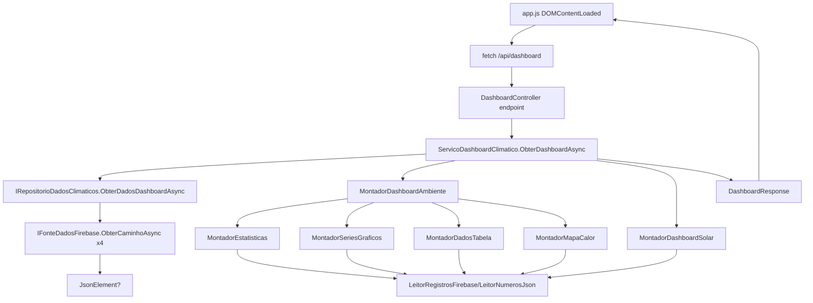

# BUSINESS_RULES

## Regra: nomenclatura interna em PT-BR

Novos metodos, funcoes e variaveis internas devem usar nomes em PT-BR para facilitar manutencao e leitura do dominio.

Excecoes permitidas:

- campos Firebase reais, como `Toluen`, `CO2`, `HourNascerDoSol` ou similares
- ids e classes DOM existentes
- contratos JSON ou HTTP publicos ja consumidos por frontend, testes ou integracoes
- propriedades exigidas por ASP.NET Core, .NET, Chart.js, Firebase, html2canvas, jsPDF ou APIs externas
- chaves estruturais ja consumidas por outros modulos, como configuracoes, payloads da assistente e contratos de relatorio

Impacto: legibilidade e consistencia com o dominio do projeto, sem quebrar contratos externos.

Criticidade: Media.

## Regra: Normalizacao de data selecionada

Arquivo: `src/EstacaoClimatica.Application/Utilities/FirebaseDate.cs`

Metodo: `Normalizar`

Objetivo: garantir uma data para consulta.

Entradas: `string? data`.

Saidas: data recebida se nao vazia; caso contrario `DateTime.Today` em `dd-MM-yyyy`.

Impacto: todo dashboard depende da data retornada.

Dependencias: `DateTime.Today`, `CultureInfo.InvariantCulture`.

O que acontece se for alterada: filtros podem consultar datas erradas.

Criticidade: Critica.

## Regra: Formato de data Firebase

Arquivo: `src/EstacaoClimatica.Application/Utilities/FirebaseDate.cs`

Metodo: `Converter`

Objetivo: converter datas Firebase no formato `dd-MM-yyyy`.

Entradas: string de data.

Saidas: `DateTime?`.

Impacto: ordenacao, filtro mensal, filtro de ultimos dias.

Dependencias: `DateTime.TryParseExact`.

O que acontece se for alterada: datas podem nao ser encontradas ou ordenadas corretamente.

Criticidade: Critica.

## Regra: Estrutura de registros Firebase

Arquivo: `src/EstacaoClimatica.Application/Utilities/FirebaseRecordReader.cs`

Metodo: `EnumerarRegistros`

Objetivo: transformar JSON data -> hora -> item em `RegistroFirebase`.

Entradas: `JsonElement? raiz`, `maisRecentesPrimeiro`.

Saidas: sequencia de `RegistroFirebase(Date, Time, Item)`.

Impacto: stats, graficos, tabelas, heatmaps.

Dependencias: `EnumerarDatas`, `ChaveOrdenacaoHora`.

O que acontece se for alterada: todo processamento ambiental e solar pode falhar.

Criticidade: Critica.

## Regra: Ordenacao de registros

Arquivo: `src/EstacaoClimatica.Application/Utilities/FirebaseRecordReader.cs`

Metodo: `EnumerarRegistros`

Objetivo: ordenar datas, horarios e itens; opcionalmente inverter para mais recentes primeiro.

Entradas: JSON Firebase e flag `maisRecentesPrimeiro`.

Saidas: registros ordenados.

Impacto: delta de estatisticas, linhas da tabela, graficos.

Dependencias: `DataFirebase.Converter`, `ConverterHora`.

O que acontece se for alterada: delta pode inverter sinal; tabela pode deixar de mostrar ultimos registros.

Criticidade: Alta.

## Regra: Parse de horario Firebase

Arquivo: `src/EstacaoClimatica.Application/Utilities/FirebaseRecordReader.cs`

Metodo: `ConverterHora`

Objetivo: converter horario com separador `-` para hora/minuto.

Entradas: string como `08-30` ou `09-00`.

Saidas: tupla `(Hour, Minute)?`.

Impacto: labels de graficos, tabelas, heatmaps horarios.

Dependencias: `int.TryParse`.

O que acontece se for alterada: horarios podem ficar sem formatacao ou ordenacao errada.

Criticidade: Alta.

## Regra: Leitura numerica flexivel

Arquivo: `src/EstacaoClimatica.Application/Utilities/JsonNumberReader.cs`

Metodo: `ObterNumero`

Objetivo: ler numeros reais do JSON.

Entradas: `JsonElement item`, uma ou mais chaves.

Saidas: `double?`.

Impacto: todas as metricas numericas.

Dependencias: `JsonElement`, `InvariantCulture`, cultura `pt-BR`.

O que acontece se for alterada: valores podem virar null e graficos/stats/tabelas ficarem vazios.

Criticidade: Alta.

## Regra: Caminhos Firebase

Arquivo: `src/EstacaoClimatica.Web/appsettings.json`

Campo: `Firebase:Paths`

Objetivo: apontar para os quatro ramos usados pelo dashboard.

Entradas: configuracao.

Saidas: caminhos usados por `ServicoDashboardClimatico`.

Impacto: dados de Quarto, Sala, Aquario e Solar.

Dependencias: Firebase Realtime Database.

O que acontece se for alterada: dados errados ou ausentes.

Criticidade: Critica.

## Regra: Leitura Firebase REST

Arquivo: `src/EstacaoClimatica.Infrastructure/Firebase/FirebaseDataSource.cs`

Metodo: `ObterCaminhoAsync`

Objetivo: ler um caminho no Firebase.

Entradas: caminho e token de cancelamento.

Saidas: `JsonElement?`.

Impacto: toda fonte de dados real.

Dependencias: `HttpClient`, `OpcoesFirebase.DatabaseUrl`.

O que acontece se for alterada: API pode parar de carregar dados.

Criticidade: Critica.

## Regra: Busca paralela dos quatro ramos

Arquivo: `src/EstacaoClimatica.Infrastructure/Repositories/FirebaseClimateDataRepository.cs`

Metodo: `ObterDadosDashboardAsync`

Objetivo: buscar Room, Solar, Aquarium e LivingRoom em paralelo.

Entradas: token de cancelamento.

Saidas: `DadosDashboardFirebase`.

Impacto: performance e completude do dashboard.

Dependencias: `IFonteDadosFirebase`, `OpcoesFirebase.Paths`.

O que acontece se for alterada: dashboard pode ficar incompleto ou mais lento.

Criticidade: Alta.

## Regra: Metricas do Quarto

Arquivo: `src/EstacaoClimatica.Application/Builders/EnvironmentDashboardBuilder.cs`

Metodo: `MontarQuarto`

Objetivo: definir dados exibidos para Quarto.

Entradas: raiz Firebase do quarto, data selecionada.

Saidas: `EnvironmentDashboard`.

Campos: `Temperatura`, `Sensacao termica`, `Umidade`.

Impacto: stats, graficos, tabela e heatmap do Quarto.

Dependencias: `MontadorEstatisticas`, `MontadorSeriesGraficos`, `MontadorDadosTabela`, `MontadorMapaCalor`.

O que acontece se for alterada: UI do Quarto muda ou perde dados.

Criticidade: Alta.

## Regra: Metricas da Sala

Arquivo: `src/EstacaoClimatica.Application/Builders/EnvironmentDashboardBuilder.cs`

Metodo: `MontarSala`

Objetivo: definir dados exibidos para Sala.

Campos de metricas: `temperatura`, `sensacaoTermica`, `umidade`, `pressao`.

Campos da tabela: `CO`, `CO2`, `Aceton`, `Alcohol`, `NH4`, `Toluen`.
Exibicao: `Toluen` aparece como Tolueno, em `ppm`.

Heatmap: `temperatura`.

Impacto: stats, graficos, tabela e heatmap da Sala.

O que acontece se for alterada: UI da Sala muda ou perde dados.

Criticidade: Alta.

## Regra: Metricas do Aquario

Arquivo: `src/EstacaoClimatica.Application/Builders/EnvironmentDashboardBuilder.cs`

Metodo: `MontarAquario`

Objetivo: definir dados exibidos para Aquario.

Campos: `temperaturaDS18B20`, `PH`, `TDS`, `Turbidez`.
Unidades: temperatura em °C, TDS em ppm e Turbidez em NTU.
Escala de leitura: TDS bruto e dividido por 10; Turbidez bruta e dividida por 1000 antes de exibir ou calcular estatisticas.

Heatmap: inexistente por `chaveMetricaHeatmap: null`.

Impacto: stats, graficos e tabela do Aquario.

O que acontece se for alterada: UI do Aquario muda ou perde dados.

Criticidade: Alta.

## Regra: Calculo de estatisticas

Arquivo: `src/EstacaoClimatica.Application/Builders/StatsBuilder.cs`

Metodo: `Montar`

Objetivo: calcular resumo por metrica.

Entradas: dados filtrados e definicoes de metricas.

Saidas: lista de `MetricSummary`.

Regras:

- media = `Average`.
- minimo = `Min`.
- maximo = `Max`.
- delta = ultimo valor - primeiro valor.
- sem valores: numericos null e tendencia estavel.

O que acontece se for alterada: cards de estatisticas mudam.

Criticidade: Alta.

## Regra: Tendencia

Arquivo: `src/EstacaoClimatica.Application/Builders/StatsBuilder.cs`

Metodo: `ObterTendencia`

Sem registros suficientes, a tendencia exibida e `--`.

Objetivo: classificar variacao.

Entradas: delta.

Saidas: `TrendInfo`.

Regras:

- `Math.Abs(delta) < 0.05`: `Estável`, `stable`, `→`.
- delta positivo: `Subindo`, `up`, `↗`.
- delta negativo: `Caindo`, `down`, `↘`.

O que acontece se for alterada: indicador visual de cards muda.

Criticidade: Media.

## Regra: Tabelas

Arquivo: `src/EstacaoClimatica.Application/Builders/TableDataBuilder.cs`

Metodo: `Montar`

Objetivo: montar linhas de tabela.

Entradas: dados e cabecalhos.

Saidas: `TableData`.

Regras:

- Usa registros mais recentes primeiro.
- Limita a 24 linhas.
- Data troca `-` por `/`.
- Hora vira `HH:mm` quando parseavel.
- Numeros usam duas casas.
- Nulos viram `--`.

O que acontece se for alterada: ordem e formato da tabela mudam.

Criticidade: Media.

### Interacao e qualidade das tabelas

- A tabela exibe a quantidade de horarios visiveis em relacao aos 24 esperados.
- O usuario pode alternar entre mais recentes e mais antigos sem perder a data da primeira linha de cada grupo.
- O CSV exporta somente a tabela visivel, em UTF-8 com BOM e separador `;`.
- Celulas criticas ou suspeitas recebem o estado calculado para a leitura correspondente.

## Regra: Heatmap mensal

Arquivo: `src/EstacaoClimatica.Application/Builders/HeatmapBuilder.cs`

Metodo: `MontarMensal`

Objetivo: criar celulas para todos os dias do mes selecionado.

Entradas: registros filtrados e data selecionada.

Saidas: lista de `HeatmapCell`.

Regra: media por dia; dias sem dados retornam null.

Criticidade: Media.

## Regra: Heatmap por hora

Arquivo: `src/EstacaoClimatica.Application/Builders/HeatmapBuilder.cs`

Metodo: `MontarPorHora`

Objetivo: criar 24 celulas para a data selecionada.

Regra: media por hora da data selecionada.

Criticidade: Media.

## Regra: Heatmap semanal

Arquivo: `src/EstacaoClimatica.Application/Builders/HeatmapBuilder.cs`

Metodo: `MontarSemanal`

Objetivo: criar matriz 7 dias x 24 horas.

Regra: considera a semana da data selecionada, reiniciando no domingo e indo somente ate a data selecionada. Calcula media por `DayOfWeek` e hora, sem agregar semanas anteriores do mes.

Criticidade: Media.

## Regra: Solar ultimos 365 dias

Arquivo: `src/EstacaoClimatica.Application/Builders/SolarDashboardBuilder.cs`

Metodo: `Montar`

Objetivo: montar historico solar recente.

Entrada: raiz solar.

Saida: quatro `ChartSeries`.

Regra: filtra dados a partir de `DateTime.Today.AddDays(-365)`.

Criticidade: Media.

## Regra: Campos solares alternativos

Arquivo: `src/EstacaoClimatica.Application/Builders/SolarDashboardBuilder.cs`

Metodo: `LerEventosSolares`

Objetivo: aceitar variacoes de nomes vindas do Firebase.

Campos:

- Amanhecer: `HoraAmanhecer`, `HourAmanhecer`.
- Nascer: `HourNascerDoSol`, `HoraNascerDoSol`.
- Por do sol: `HoraPorDoSol`, `HourPorDoSol`.
- Anoitecer: `HourAnoitecer`, `HoraAnoitecer`.
- Zenite: `HoraZenite`, `HourZenith`, `HoraZenith`, `HourZenite`, `HoraZênite`.

Criticidade: Alta.

## Regra: Zenite solar fallback

Arquivo: `src/EstacaoClimatica.Application/Builders/SolarDashboardBuilder.cs`

Metodo: `LerEventosSolares`

Objetivo: criar zenite mesmo sem campo dedicado.

Regra: se zenite null, usar `nascerSol + ((porDoSol - nascerSol) / 2)`.

Criticidade: Media.

## Regra: Renderizacao de data no frontend

Arquivo: `src/EstacaoClimatica.Web/wwwroot/app.js`

Metodos: `paraDataFirebase`, `paraDataInput`, `deDataInput`

Objetivo: converter entre Date/HTML input/Firebase.

Criticidade: Critica.

## Regra: Persistencia de aba

Arquivo: `src/EstacaoClimatica.Web/wwwroot/app.js`

Metodo: `abrirAba`

Objetivo: salvar aba ativa em `localStorage.activeTab`.

Criticidade: Baixa.

## Regra: Navegacao touch entre abas

Arquivo: `src/EstacaoClimatica.Web/wwwroot/app.js`

Metodo: `configurarNavegacaoTouch`

Objetivo: permitir troca de abas por gesto horizontal em telas touch.

Regra: a ordem fixa e `Tab0`, `Tab1`, `Tab2`, `Tab3`; gesto para esquerda avanca, gesto para direita volta; gesto vertical ou curto e ignorado.
Gestos iniciados em tabelas, heatmaps ou areas com rolagem horizontal nao trocam de aba, permitindo arrastar lateralmente esses conteudos.

Criticidade: Media.

## Regra: Abas e toolbar em celular paisagem

Arquivos: `src/EstacaoClimatica.Web/wwwroot/styles/responsive.css`, `src/EstacaoClimatica.Web/wwwroot/index.html`.

Objetivo: impedir que as abas disputem espaco horizontal com os controles globais em celulares com pouca altura disponivel.

Regra: quando `orientation: landscape`, `max-height: 540px` e `max-width: 900px` forem atendidos, Estação, Sala, Quarto e Aquario devem ocupar uma linha exclusiva em quatro colunas equivalentes. A toolbar deve ocupar a linha seguinte em largura total, mantendo data, Hoje, PDF/JSON e exportacao sem quebra indevida, sobreposicao ou overflow horizontal.

O breakpoint nao altera desktop nem celular em retrato. Clique, swipe, `ArrowLeft`, `ArrowRight`, `Home`, `End`, foco movel, `aria-selected`, data, exportacao, chat e popovers do header permanecem com o mesmo comportamento.

Teste de regressao: viewport `720x360`, data `03/06/2026`, em `TestesInterfaceNavegador.ModoInternoCelularPaisagem_DeveSepararAbasEToolbarSemPerderInteracoes`.

Criticidade: Media.

## Regra: Faixa de conforto

Arquivo: `src/EstacaoClimatica.Web/wwwroot/app.js`

Constante/metodo: `faixaConforto`, `pluginFaixaConforto`, `deveMostrarFaixaConforto`

Objetivo: destacar graficos conforme a faixa de conforto da metrica.

Faixas:
- temperatura/sensacao ambiental: 20°C a 26°C;
- umidade: 40% a 60%;
- temperatura do Aquario: 25°C a 27°C.

Os graficos usam escala Y derivada dos dados medidos; a faixa de conforto e recortada ao trecho visivel e nao altera `suggestedMin`/`suggestedMax`.

Regra: aplica em series com sufixo `°` e id/label contendo temp/sensacao.

Criticidade: Media.

## Regra: Indicadores contextuais do header

Arquivos: `src/EstacaoClimatica.Web/wwwroot/index.html`, `src/EstacaoClimatica.Web/wwwroot/scripts/season.js`, `src/EstacaoClimatica.Web/wwwroot/scripts/moon.js`, `src/EstacaoClimatica.Web/wwwroot/scripts/ui.js`, `src/EstacaoClimatica.Web/wwwroot/styles/header.css`

Objetivo: manter, na ordem do projeto Web original, os chips visuais de estação do ano, AQI, ciclo solar, fase da lua e relógio.

Regras:

- estação do ano e fase da lua são calculadas localmente no frontend, sem API externa;
- os chips visuais não exibem texto interno longo; detalhes ficam em `title`, `aria-label` e popovers;
- o chip de ciclo solar permanece sem texto interno;
- clique fora e tecla `Esc` fecham o popover aberto.

Criticidade: Media.

## Regra: Indicador astronomico do header

Arquivos: `src/EstacaoClimatica.Web/wwwroot/index.html`, `src/EstacaoClimatica.Web/wwwroot/app.js`, `src/EstacaoClimatica.Web/wwwroot/style.css`

Metodos principais: `configurarIndicadorAstronomico`, `atualizarIndicadorAstronomico`, `obterEstadoAstronomico`

Objetivo: mostrar apenas o indicador visual no header; o tooltip e o `aria-label` exibem os horarios de nascer e por do sol.

Regra: usa `dashboard.solar.currentDay` no header e `dashboard.solar.day` no grafico da data selecionada. Antes dos dados ou sem dados solares atuais, usa fallback com dia entre 06:00 e 18:00. Assim, abrir `03/06/2026` nao altera o ciclo solar corrente do cabecalho.

Criticidade: Media.

## Regra: Qualidade operacional dos sensores

Arquivos: `DataQualityBuilder.cs`, `StatsBuilder.cs`, `TableDataBuilder.cs`, `dashboard-view.js`.

- Cobertura minima: 90% das leituras esperadas.
- Frequencia padrao: 24 leituras por dia; no dia atual, limita a expectativa ate a hora corrente.
- Estados: `OK`, `Parcial`, `Desatualizado`, `Suspeito` e `Offline`.
- Niveis visuais: adequada, incompleta, desatualizada, suspeita, critica e sem dados.
- Uma unica leitura preserva o valor, mas nao produz delta nem tendencia conclusiva.
- Series de pH detectam faixa critica, saltos e repeticao; Turbidez constante em zero e sinalizada sem descartar os zeros.
- A qualidade exibida no grafico e a analise do dia selecionado, mesmo quando a serie visual usa janela movel de 24 horas.

Criticidade: Alta.

## Regra: Estado da consulta publica

Arquivos: `public-weather.js`, `config.js`, `public-weather.css`.

- CEP recebe mascara e `aria-invalid` enquanto a mensagem e anunciada em regiao viva.
- O controle segmentado alterna entre CEP e Cidade e preserva um valor independente para cada modo.
- Busca em andamento aplica `aria-busy` e desabilita os controles envolvidos.
- Uma resposta antiga nao pode substituir uma consulta mais recente.
- A ultima consulta pode ser restaurada de `sessionStorage` por ate 60 minutos.
- Latitude, longitude, precisao e CEP de origem nao sao persistidos no cache da sessao.
- Resultado com mais de 20 minutos e identificado como desatualizado.

Criticidade: Alta.

## Regra: Pesquisa publica por cidade

Arquivos: `PublicWeatherModels.cs`, `IPublicWeatherService.cs`, `PublicWeatherService.cs`, `PublicWeatherController.cs`, `index.html`, `public-weather.js`, `public-weather.css`.

- O termo deve conter pelo menos dois caracteres depois de remover espacos excedentes.
- A Open-Meteo Geocoding recebe `countryCode=BR`, `language=pt`, `format=json` e no maximo dez candidatos.
- Candidatos sem latitude/longitude validas sao removidos; duplicatas reais usam id e coordenadas; a resposta final tem no maximo cinco cidades.
- Correspondencias exatas com o nome pesquisado aparecem antes das parciais, ignorando acentos, caixa e espacos excedentes.
- O rotulo principal segue `Gramado - Rio Grande do Sul`; homonimos seguem `Gramado (Sobradinho) - Rio Grande do Sul`. A regiao administrativa so aparece quando difere do nome e do estado.
- Resultado unico consulta o clima diretamente. Resultados ambiguos viram botoes acessiveis e o primeiro recebe foco.
- A cidade escolhida reutiliza a consulta por coordenadas e recebe os mesmos cards, insights, contexto astronomico, ciclo solar e graficos de CEP/localizacao.
- Cidade curta, cidade nao encontrada, falha de geocodificacao, coordenadas invalidas e falha climatica possuem mensagens distintas.
- Texto vindo das APIs e inserido com `textContent` ou escapado antes de entrar em HTML.
- A sequencia de busca cobre geocodificacao e clima; somente a resposta mais recente pode renderizar ou encerrar o estado ocupado.

Criticidade: Alta.

## Regra: Previsao nos graficos meteorologicos publicos

Arquivos: `PublicWeatherService.cs`, `public-weather.js`, `zoom.js`.

- Temperatura, Sensacao Termica, Umidade e Pressao usam a mesma fonte horaria normalizada.
- A janela medida cobre as 24 horas anteriores ate o instante atual da API. A previsao comeca na proxima hora cheia e cobre 12 horas, sem repetir o ponto atual.
- A serie medida usa linha solida e a cor principal; a previsao usa tom mais claro e linha tracejada. Uma linha vertical identifica `Agora`.
- A legenda compacta diferencia `Medido` de `Previsao`, e o tooltip informa explicitamente a origem sem remover a unidade da metrica.
- Ausencia de medicao ou previsao permanece `null`; zero continua sendo um valor valido.
- Todos os pontos permanecem no mobile. Somente a densidade de rotulos do eixo X e reduzida, e o zoom continua acessivel por toque.
- O zoom deve preservar datasets, estilos, marcador `Agora`, origem do tooltip, unidades e recursos de acessibilidade.
- O grafico solar, o dashboard privado, autenticacao, exportacoes e Firebase nao usam essa composicao temporal.
- `ServicoClimaPublico` obtem dados suficientes em uma unica chamada Open-Meteo Forecast com `timezone=auto`, `past_hours=24`, `forecast_hours=13` e `forecast_days=15`, inclusive quando a janela cruza a meia-noite.
- A consulta diaria pede `temperature_2m_min`, `temperature_2m_max`, `precipitation_sum`, `precipitation_probability_max`, `uv_index_max` e `weather_code`, alem dos eventos solares existentes.
- `PrevisaoQuinzeDias` combina arrays pela posicao da data, limita a 15 itens, ordena cronologicamente e conserva campos ausentes como `null`. Do 8o ao 15o item, `MaiorIncerteza` e verdadeiro sem alterar os valores da API.
- A previsao de 15 dias aparece depois dos cinco graficos curtos e antes do ciclo solar: faixa `Data | Max. | Chuva | UV`, temperatura minima/maxima, chuva percentual/mm e UV maximo.
- Se os agregados diarios estiverem ausentes, clima atual, insights, graficos curtos e ciclo solar permanecem na tela. O bloco diario mostra estado indisponivel e permite nova tentativa sem limpar os dados ja carregados.
- Acima de 1100 px os graficos curtos usam grade 3 + 2 sem celula vazia; de 641 a 1100 px usam duas colunas; ate 640 px viram carrossel. Os tres graficos diarios ficam em tres colunas acima de 640 px e carrossel abaixo disso.
- Faixa e graficos diarios sincronizam a mesma data por ponteiro, toque, foco, `ArrowLeft`, `ArrowRight`, `Home` e `End`; ao sair do conjunto, selecao e tooltips sao removidos.

Criticidade: Alta.

## Regra: Exportacao com recuperacao

Arquivos: `pdf-report.js`, `index.html`, `tabs-toolbar.css`.

- PDF e JSON informam progresso em regiao viva.
- A operacao tem timeout de 45 segundos.
- Falha exibe mensagem e acao para tentar novamente sem recarregar a pagina.

Criticidade: Media.

## Regra: Popovers do header

Arquivos: `src/EstacaoClimatica.Web/wwwroot/index.html`, `src/EstacaoClimatica.Web/wwwroot/scripts/ui.js`, `src/EstacaoClimatica.Web/wwwroot/styles/header.css`

Objetivo: mostrar detalhes do AQI estimado e do ciclo solar sem ocupar espaco fixo no header.

Regras:

- o indicador astronomico permanece sem texto interno;
- clique/toque no indicador astronomico abre popover com amanhecer, nascer do sol, zenite, por do sol, anoitecer, estado atual e duracao do dia;
- clique fora e tecla `Esc` fecham o popover aberto;
- abrir qualquer popover contextual do header fecha os demais.

Criticidade: Media.

## Regra: AQI estimado da Sala

Arquivos: `src/EstacaoClimatica.Web/wwwroot/scripts/ui.js`, `src/EstacaoClimatica.Application/Services/ClimateChatService.cs`, `src/EstacaoClimatica.Domain/DashboardModels.cs`

Objetivo: fornecer leitura rapida da qualidade do ar estimada da Sala/MQ135 no header.

Campos considerados: `CO`, `CO2`, `Toluen`, `NH4`, `Aceton`, `Alcohol`.

Regras:

- o valor e estimado, nao medicao certificada;
- categorias visuais seguem faixas AQI: 0-50 Boa, 51-100 Moderado, 101-150 Insalubre para grupos sensiveis, 151-200 Insalubre, 201-300 Muito insalubre, 301+ Perigoso;
- o popover mostra classificacao, impacto, dominante, horario e subindices principais;
- perguntas sobre AQI/IAQ/qualidade do ar pertencem a Sala/MQ135;
- o chat calcula AQI estimado no backend C# antes da redacao da IA, sem enviar o Firebase inteiro ao modelo.

Criticidade: Media.

## Regra: Zoom de graficos

Arquivo: `src/EstacaoClimatica.Web/wwwroot/app.js`

Metodos: `adicionarBotaoZoom`, `garantirCartaoComZoom`, `manipularZoom`, `fecharZoom`

Objetivo: ampliar graficos em overlay.

Regras:

- todos os cards de grafico internos e publicos recebem botao de ampliacao e duplo clique;
- o dialogo inicia o foco no botao Fechar e contem `Tab` e `Shift+Tab`;
- `Escape`, botao Fechar e clique no fundo encerram o dialogo;
- ao fechar, o foco retorna ao acionador e a posicao de scroll da pagina e preservada;
- dispositivos touch recebem a classe e as protecoes de eventos equivalentes ao projeto original;
- o grafico ampliado preserva dados, unidade do eixo, configuracao solar e faixa de conforto.

Criticidade: Media.

## Regra: Mensagens de grafico vazio

Arquivo: `src/EstacaoClimatica.Web/wwwroot/app.js`

Metodo: `renderizarGraficoLinha`, `renderizarMensagemGrafico`

Objetivo: informar falta de dados.

Regra: se nenhuma `series.points` tem valor finito, nao cria Chart e mostra mensagem.

Criticidade: Media.

## Regra: Exportacao PDF/JSON

Arquivos: `src/EstacaoClimatica.Web/wwwroot/app.js`, `src/EstacaoClimatica.Web/wwwroot/pdf-report.css`, `src/EstacaoClimatica.Web/wwwroot/vendor/*`

Metodos principais: `configurarExportacaoDados`, `exportarAbaAtiva`, `montarRelatorioPdf`, `gerarPdf`, `exportarRelatorioJson`

Objetivo: exportar a aba ativa para PDF ou JSON.

Regras:

- Usa `dashboardAtual`, isto e, dados ja carregados pela chamada atual da API.
- Nao faz nova consulta ao Firebase.
- Exporta cabecalho, indice, resumo, graficos e tabela quando a aba possuir tabela.
- Estação: cards contextuais de estação/lua, 6 cards globais, gráficos comparativos e ciclo solar; não possui tabela.
- Sala: resumo/graficos ambientais e tabela MQ135 (`CO`, `CO2`, `Acetona`, `Álcool`, `Amônia`, `Tolueno`), sem solar.
- Quarto: resumo/graficos ambientais e tabela ambiental (`Temperatura`, `Sensação térmica`, `Umidade`), sem solar.
- Aquario: resumo/graficos/tabela de `Temperatura`, `PH`, `TDS` e `Turbidez`; nao inclui card, grafico ou zenite solar.
- O ciclo solar do PDF e renderizado em canvas offscreen com os horarios solares ja carregados e as opcoes/plugin visual do grafico da tela; nao depende de capturar canvas visivel/oculto.
- Sem dados solares, o card de grafico solar mostra estado vazio.
- JSON inclui metadados, resumo, graficos, `tabela`, `tabelaResumida`, `tabelaDetalhada`, `dadosBrutos` e `dadosDaAba`.
- `html2canvas`, `window.jspdf` e `pdf-report.css` sao carregados sob demanda somente ao exportar PDF.

Criticidade: Media.

# REGRAS QUE NAO DEVEM SER ALTERADAS

- Formato de data Firebase `dd-MM-yyyy`.
- Estrutura data -> hora -> item no Firebase.
- Nomes dos campos Firebase usados em `MontadorDashboardAmbiente`, incluindo `Toluen` para Tolueno na Sala/MQ135.
- Variantes de campos solares usadas em `MontadorDashboardSolar`.
- Caminhos Firebase em `appsettings.json`, salvo mudanca coordenada no banco.
- Contrato de `DashboardModels.cs` sem ajuste simultaneo de `app.js`.
- Leitura numerica com suporte a numero JSON, string invariant e string `pt-BR`.
- Limite de 24 linhas de tabela, se a UI atual depender desse volume.
- Ordem de abas touch `Tab0` -> `Tab1` -> `Tab2` -> `Tab3`.
- Indicador astronomico com fallback 06:00-18:00 quando nao houver dados solares atuais.
- Exportacao PDF/JSON sem nova consulta ao Firebase.
- Cache Firebase curto por URL configurado em `Firebase:CacheDurationSeconds`.
- Retry/backoff Firebase configurado por `Firebase:MaxRetryAttempts`.
- Campos Firebase de ambiente e solar centralizados em `CamposFirebase`.
- IA/App Check configurados; IA fica desativada por padrao e o chat usa resposta local quando nao houver IA habilitada.

## Regra: Assistente climatico, IA e App Check

Arquivos: `src/EstacaoClimatica.Application/Services/ClimateChatService.cs`, `src/EstacaoClimatica.Web/Controllers/ChatController.cs`, `src/EstacaoClimatica.Infrastructure/AI/GeminiTextGenerationClient.cs`, `src/EstacaoClimatica.Application/Configuration/AiOptions.cs`, `src/EstacaoClimatica.Web/appsettings.json`, `src/EstacaoClimatica.Web/Program.cs`.

Objetivo: responder perguntas sobre os dados da estacao usando calculo local em C# e IA opcional sem expor segredo no frontend.

Estado atual: o chat foi migrado para `/api/chat`. `ArtificialIntelligence:Enabled` fica `false` por padrao; nesse modo, as respostas usam apenas calculo local. Quando habilitada, a IA classifica/redige, mas nao recebe o Firebase inteiro.

Regras:

- nenhuma chave secreta de IA deve ficar em `wwwroot`, `appsettings.json` versionado ou codigo-fonte;
- chaves privadas devem vir de variaveis de ambiente, User Secrets ou cofre externo;
- chaves publicas Firebase/App Check podem existir no cliente quando forem necessarias, mas devem ser protegidas por App Check, regras e cotas;
- `ArtificialIntelligence:MaxPeriodDays` preserva o limite de seguranca de 30 dias usado no Web para consultas por periodo;
- `ArtificialIntelligence:RequireAppCheck` e enforcement de App Check so devem ser ativados depois de validar tokens no dominio de producao;
- a IA nao deve receber o Firebase inteiro; o fluxo deve interpretar a intencao, calcular localmente e enviar apenas o resultado calculado para redacao.
- perguntas com hora especifica (`14h`, `14:00`, `as 14`) devem comparar a hora com chaves Firebase `HH-MM` e responder somente o valor daquele horario, sem media/minima/maxima/delta/amostras;
- perguntas de continuidade devem usar a memoria curta enviada em `PreviousIntent` para herdar ambiente, metrica, operacao, periodo, hora e faixa horaria quando a nova pergunta omitir esses dados;
- perguntas de valor atual/agora/ultima medicao, ou perguntas simples `qual o/a <metrica>` sem pedir media, maxima, minima, tendencia, faixa ou periodo inteiro, devem retornar a ultima amostra disponivel no recorte consultado;
- metricas exclusivas de ambiente devem redirecionar para o ambiente que possui a medicao. CO, CO2, Acetona, Alcool, Amonia, Tolueno e AQI/IAQ pertencem a Sala/MQ135 mesmo se a aba ativa for Quarto ou Aquario.
- perguntas sobre AQI/IAQ/qualidade do ar devem usar os dados da Sala/MQ135 e calcular AQI estimado em C# com os mesmos poluentes e faixas do indicador do header;
- perguntas com faixa horaria (`entre 8h e 18h`, `das 8 as 18`) devem filtrar registros de forma inclusiva antes de calcular estatisticas;
- perguntas com `ultimos X dias` preservam a quantidade informada, inclusive numeros por extenso, e usam a data selecionada como fim da janela; o limite superior e `MaxPeriodDays` (30 por padrao);
- perguntas com `ultimas X horas` preservam a janela movel solicitada, aceitando ate `MaxPeriodDays * 24` horas; 48 horas nao e convertido para sete dias;
- medias, maximas, minimas, tendencia e delta retornam o tipo de resultado correspondente a operacao pedida, sem acrescentar estatisticas nao solicitadas;
- perguntas de faixa, conforto e horas fora da faixa sao resolvidas como `status_faixa` antes de qualquer comparacao entre dias;
- perguntas de horario mais quente/frio e dia mais quente/frio mantem a granularidade solicitada e nao sao classificadas como comparacao generica;
- atalhos de Resumo, Maxima e Alertas usam o contexto da aba ativa; na aba Estacao, Resumo e Maxima consultam os ambientes internos sem cair no ramo solar;
- perguntas sobre `ultimas 24 horas` devem usar janela movel real, terminando no horario atual aplicado a data selecionada;
- perguntas de comparacao entre dias devem retornar o dia com maior media diaria, o dia de referencia e a diferenca entre medias;
- perguntas de faixa/status/conforto devem usar as faixas configuradas: temperatura/sensacao 20°C a 26°C, umidade 40% a 60% e temperatura do Aquario 25°C a 27°C;
- perguntas equivalentes aos heatmaps devem calcular localmente: calendario mensal por dia, hora do dia no mes e mapa semanal por dia/hora;
- perguntas solares devem calcular localmente ciclo solar, duracao do dia, maior/menor duracao de luz, tendencia e comparacao de nascer/por do sol; maior/menor duracao usa ano selecionado por padrao e mes quando um mes e mencionado.
- o zoom dos graficos e um dialogo acessivel, com `role="dialog"`, `aria-modal="true"`, nome acessivel, foco inicial, fechamento por fundo/botao/Esc e retorno do foco ao disparador.

# MAPA DE IMPACTO

## `src/EstacaoClimatica.Domain/DashboardModels.cs`

Responsabilidade: contrato JSON.

Pode quebrar: frontend, testes, serializacao.

Dependencias afetadas: `app.js`, `ServicoDashboardClimatico`, builders.

Nivel de risco: Critico.

## `src/EstacaoClimatica.Application/Services/ClimateDashboardService.cs`

Responsabilidade: orquestracao.

Pode quebrar: todo dashboard.

Dependencias afetadas: Firebase, builders, API.

Nivel de risco: Critico.

## `src/EstacaoClimatica.Web/Controllers/DashboardController.cs`

Responsabilidade: endpoints HTTP.

Pode quebrar: rotas `/api/dashboard` e `/api/health`.

Dependencias afetadas: frontend, clientes HTTP, testes de endpoint.

Nivel de risco: Critico.

## `src/EstacaoClimatica.Infrastructure/Repositories/FirebaseClimateDataRepository.cs`

Responsabilidade: carregar dados brutos dos quatro ramos Firebase.

Pode quebrar: completude do dashboard.

Dependencias afetadas: `ServicoDashboardClimatico`, Firebase, API.

Nivel de risco: Alto.

## `src/EstacaoClimatica.Application/Utilities/FirebaseRecordReader.cs`

Responsabilidade: leitura da estrutura Firebase.

Pode quebrar: stats, graficos, tabelas, heatmaps, solar.

Nivel de risco: Critico.

## `src/EstacaoClimatica.Web/wwwroot/app.js`

Responsabilidade: frontend.

Pode quebrar: UI completa, Chart.js, zoom, heatmaps, fetch.

Nivel de risco: Critico.

## `src/EstacaoClimatica.Web/wwwroot/pdf-report.css`

Responsabilidade: visual do relatorio PDF.

Pode quebrar: layout e paginacao do PDF.

Nivel de risco: Medio.

## `src/EstacaoClimatica.Web/appsettings.json`

Responsabilidade: configurar Firebase e cores.

Pode quebrar: fonte de dados e cores de graficos.

Nivel de risco: Alto.

# CALL GRAPH

# GLOSSARIO

- Sala: ambiente `historico/AirQuality`.
- Quarto: ambiente `historico/Temperatura`.
- Aquario: ambiente `historico/Aquario`.
- Solar: dados de nascer/por do sol em `historico/NascePorDoSol`.
- Firebase: Firebase Realtime Database acessado por REST.
- `dd-MM-yyyy`: formato de data usado para chaves Firebase.
- `HH-mm`: formato esperado para chaves de hora Firebase.
- Heatmap: visualizacao de intensidade por cor.
- TDS: campo do aquario.
- PH: campo do aquario.
- Turbidez: campo do aquario.
- CO/CO2/NH4: campos de qualidade do ar da Sala.
- Aceton/Alcohol/Toluen: campos de gases da Sala, exibidos como Acetona/Álcool/Tolueno.
- Toluen: campo Firebase exibido como Tolueno, unidade ppm.
- Chat: `Toluen`/Tolueno e aceito como metrica consultavel da Sala/MQ135.
- Zenite: ponto maximo do ciclo solar.
- Chart.js: biblioteca de graficos do frontend.
- html2canvas: biblioteca usada para capturar blocos HTML no PDF.
- jsPDF: biblioteca usada para montar e baixar o PDF.

# CODIGO MORTO

- Nenhum codigo morto pendente identificado no estado atual.

# DIVIDA TECNICA

- Frontend modularizado ainda usa scripts classicos carregados em ordem e funcoes registradas em `window`; migrar para ES modules reduziria dependencia de ordem global.
- Firebase Auth e usado como portao de experiencia; `/api/dashboard` e `/api/chat` validam o ID token e a allowlist no backend.
- Algumas consultas historicas ainda podem filtrar em memoria depois do carregamento, mas o repository ja tenta leituras Firebase mais estreitas por data/path para o dashboard quando aplicavel.
- Ainda existem rotulos, ids de DOM, ids de graficos e nomes de secoes de UI como literais no frontend/backend.

# TAREFAS COMUNS

## Se quiser alterar graficos

Leia:

- `EnvironmentDashboardBuilder.cs`
- `ChartSeriesBuilder.cs`
- `DashboardModels.cs`
- `app.js`
- `style.css`

## Se quiser alterar Firebase

Leia:

- `appsettings.json`
- `FirebaseOptions.cs`
- `FirebaseDataSource.cs`
- `FirebaseRecordReader.cs`
- `ClimateDashboardService.cs`

## Se quiser alterar calculos

Leia:

- `StatsBuilder.cs`
- `HeatmapBuilder.cs`
- `SolarDashboardBuilder.cs`
- `JsonNumberReader.cs`
- `ClimateDashboardServiceTests.cs`

## Se quiser alterar API

Leia:

- `Program.cs`
- `DashboardController.cs`
- `DashboardModels.cs`
- `ClimateDashboardService.cs`
- `app.js`

## Se quiser alterar frontend

Leia:

- `index.html`
- `app.js`
- `style.css`
- `DashboardModels.cs`

## Se quiser alterar touch, PDF ou JSON

Leia:

- `index.html`
- `app.js`
- `pdf-report.css`
- `src/EstacaoClimatica.Web/wwwroot/vendor`

## Se quiser alterar sensores/campos

Leia:

- `EnvironmentDashboardBuilder.cs`
- `SolarDashboardBuilder.cs`
- `TableDataBuilder.cs`
- `appsettings.json`

## Regras de insights ambientais

Arquivo principal: `src/EstacaoClimatica.Application/Services/EnvironmentalInsightsService.cs`

- Ponto de orvalho externo usa `dew_point_2m` quando presente; Sala e Quarto calculam localmente pela equacao de Magnus.
- Risco estimado de mofo considera umidade relativa e margem entre temperatura e ponto de orvalho: `Risco baixo`, `Monitorar`, `Atencao`, `Risco alto` ou `Indisponivel`.
- O resultado e orientativo e nao representa diagnostico, laudo ou medicao certificada.
- Chuva considera apenas a janela entre a hora atual retornada para a localizacao e as 6 horas seguintes.
- Chuva apresenta maior probabilidade, intensidade maxima em mm/h, acumulado em mm, horario do pico e classificacao.
- Sem pontos horarios na janela, probabilidade, intensidade e acumulado ficam nulos; ausencia nunca e exibida como `0%`.
- UV usa o valor atual e maxima diaria. Se o atual faltar, a maxima pode ser usada como fallback explicitamente identificado; ambos ausentes resultam em `Indisponivel`.
- Faixas UV: abaixo de 3 `Baixo`; 3 a 5,99 `Moderado`; 6 a 7,99 `Alto`; 8 a 10,99 `Muito alto`; 11 ou mais `Extremo`.
- Ventilacao publica considera temperatura, umidade, AQI, chuva e rajadas externas.
- Ventilacao privada considera temperatura/umidade da Sala, AQI estimado e risco de mofo. A combinacao externa so ocorre depois de acao explicita do usuario.
- Coordenadas de geolocalizacao nao sao gravadas em Firebase, banco, arquivo, cookie ou `localStorage`.
- O chip de duracao solar so aparece com eventos solares validos. `daylightDuration` da Open-Meteo e usado quando disponivel e a subtracao `sunset - sunrise` e o fallback; o ciclo interno calcula diretamente pelos eventos.
- A grade de insights nao possui cabecalho visual separado; no privado, a acao de localizacao fica dentro do card de chuva.

## Regras de chuva e sincronizacao de graficos

- Pontos ambientais possuem `instante` ISO opcional. O rotulo continua visual; o instante serve para correlacao e preserva virada de dia.
- Graficos do mesmo grupo priorizam instante identico e aceitam o mais proximo somente ate 45 minutos.
- Pontos `null` continuam lacunas: nao recebem destaque, nao viram zero e nao unem segmentos.
- Sair do ponto ou destruir/substituir um grafico limpa o grupo. Solar e overlay de zoom nao participam.
- Chuva usa 24 horas anteriores ate `atualizadoEm` e 12 horas previstas apos a proxima hora cheia.
- Precipitacao usa barras distintas; chance usa linha tracejada, eixo direito 0-100%, enquanto milimetros ficam a esquerda.
- O estado atual e `Chovendo agora`, `Sem chuva agora` ou `Condicao atual indisponivel` conforme precipitacao, chuva e codigo meteorologico.
- Na Estacao, a localizacao nunca e automatica. Antes do clique existe estado vazio acionavel; depois, o grafico usa a resposta em memoria.
- Exportacao da Estacao acrescenta chuva somente com clima externo em memoria, nao repete consulta e nao serializa latitude, longitude, precisao ou CEP.
- Sem clima externo, PDF e JSON preservam a estrutura anterior.
