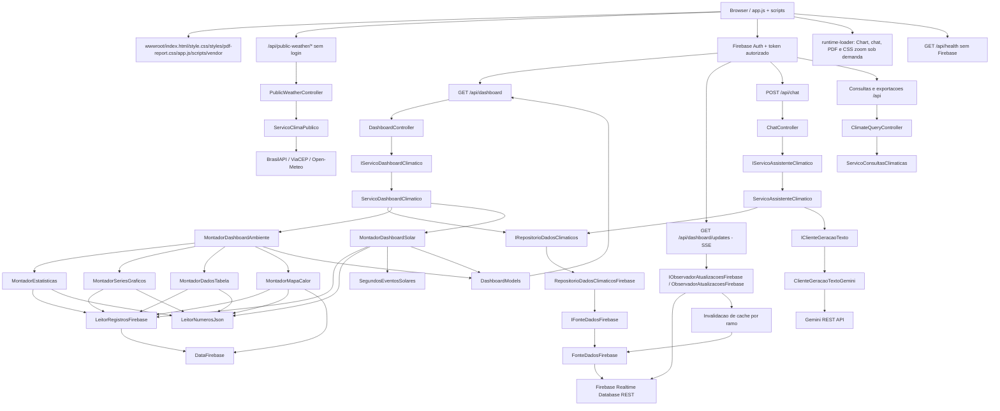
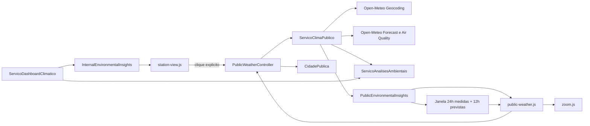
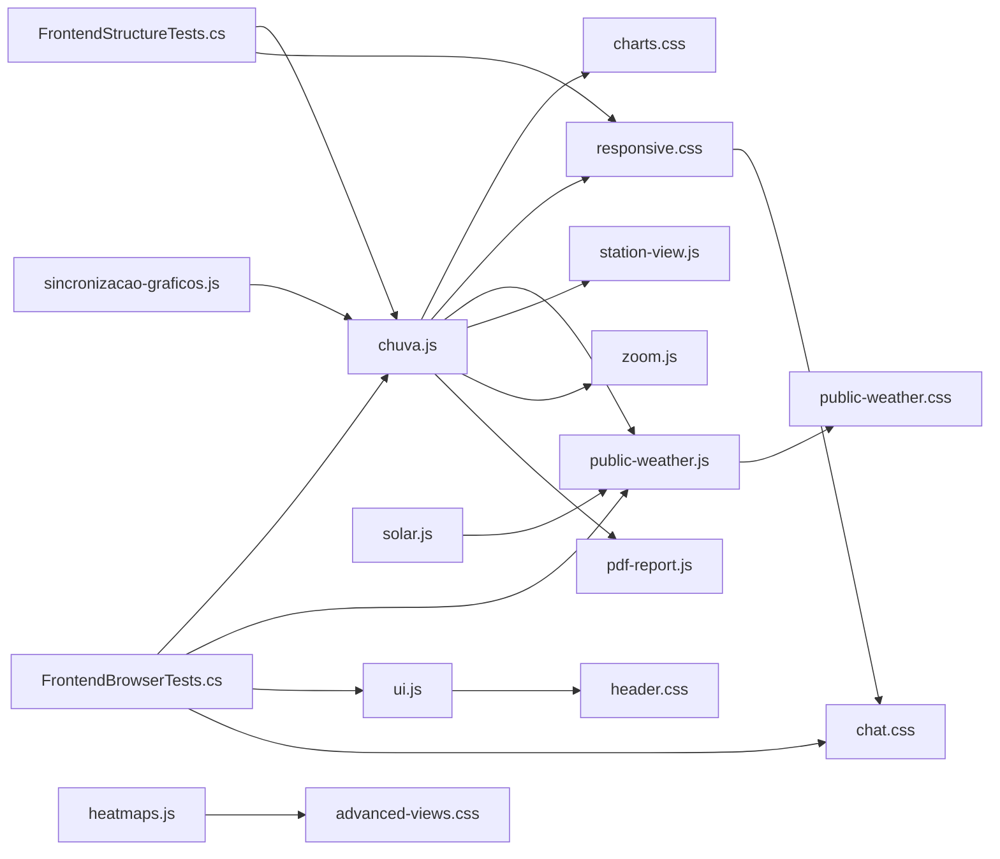

# DEPENDENCY_MAP

## Visao Geral



## Solucao

### EstacaoClimatica.Domain

Responsabilidade: definir records publicos de resposta.

Dependencias diretas: nenhuma referencia de projeto.

Dependencias indiretas: .NET `System.Collections.Generic`.

Quem chama: Application builders e Web via retorno serializado.

Quem e chamado: nenhum modulo de negocio.

Impacto da alteracao: Critico. Mudancas de nomes/propriedades quebram contrato da API e `app.js`.

### EstacaoClimatica.Application

Responsabilidade: regras de negocio, montagem de dashboard, abstracoes, modelos internos e utilitarios.

Dependencias diretas: `EstacaoClimatica.Domain`.

Dependencias indiretas: `System.Text.Json`, LINQ, cultura/numeros.

Quem chama: `EstacaoClimatica.Web`, `EstacaoClimatica.Infrastructure` via interface, `EstacaoClimatica.Tests`.

Quem e chamado: Domain.

Impacto da alteracao: Alto a Critico conforme regra alterada.

### EstacaoClimatica.Infrastructure

Responsabilidade: acesso concreto ao Firebase.

Dependencias diretas: `EstacaoClimatica.Application`, `EstacaoClimatica.Domain`.

Dependencias indiretas: `HttpClient`, `System.Text.Json`.

Quem chama: Web por DI quando resolve `IRepositorioDadosClimaticos` e `IFonteDadosFirebase`.

Quem e chamado: Application abstractions/config.

Impacto da alteracao: Alto. Pode interromper leitura de dados reais.

### EstacaoClimatica.Web

Responsabilidade: host ASP.NET Core, endpoints e frontend estatico.

Dependencias diretas: `EstacaoClimatica.Application`, `EstacaoClimatica.Infrastructure`.

Dependencias indiretas: ASP.NET Core shared framework, Chart.js no carregamento inicial e html2canvas/jsPDF sob demanda na exportacao PDF.

Quem chama: navegador/cliente HTTP.

Quem e chamado: Application e Infrastructure.

Impacto da alteracao: Critico para disponibilidade da aplicacao.

### EstacaoClimatica.Tests

Responsabilidade: validar regras principais do servico.

Dependencias diretas: `EstacaoClimatica.Application`, `EstacaoClimatica.Domain`, `EstacaoClimatica.Web`, xUnit e Microsoft Playwright.

Dependencias indiretas: `Microsoft.NET.Test.Sdk`, `coverlet.collector`, browser Chromium/Edge para testes reais de frontend.

Quem chama: `dotnet test`.

Quem e chamado: Application e Domain.

Impacto da alteracao: Medio. Nao afeta runtime, mas reduz confianca se quebrado.

## Modulos

### FirebaseAccessTokenVerifier.cs

Valida Firebase ID token para as rotas internas e retorna o e-mail normalizado usado pela allowlist.

### auth.js

Inicializa Firebase Auth, controla login/logout, verifica `/api/internal-access` e adiciona Bearer token às chamadas internas.

### public-weather.js

Controla a primeira tela anônima por CEP, cidade ou geolocalização. Preserva os valores dos modos CEP/Cidade, renderiza candidatos homonimos acessiveis, controla concorrencia e carrega cards, contexto sazonal/lunar e gráficos externos. Monta uma janela temporal unica para Temperatura, Sensacao Termica, Umidade e Pressao, separa Medido de Previsao, desenha o marcador `Agora` e publica os metadados consumidos pelo zoom.

### Program.cs

Responsabilidade: configurar DI, controllers e static files.

Dependencias diretas:

- `IServicoDashboardClimatico`
- `ServicoDashboardClimatico`
- `IRepositorioDadosClimaticos`
- `RepositorioDadosClimaticosFirebase`
- `IFonteDadosFirebase`
- `FonteDadosFirebase`
- `OpcoesFirebase`
- `CoresAplicacao`
- `OpcoesIa`

Dependencias indiretas:

- ASP.NET Core
- appsettings.json

Quem chama: ASP.NET runtime.

Quem e chamado:

- `MapControllers`

Impacto da alteracao: Critico.

### AiOptions.cs

Responsabilidade: representar configuracao de IA/Gemini sem expor segredo no frontend. As opcoes de App Check ainda nao sao aplicadas.

Dependencias diretas: nenhuma.

Quem chama:

- `Program.cs` registra como singleton a partir de `ArtificialIntelligence`.

Quem e chamado:

- `ServicoAssistenteClimatico`
- `ClienteGeracaoTextoGemini`

Observacao: `ArtificialIntelligence:Enabled` fica `false` por padrao. Segredos de IA devem vir de variaveis de ambiente, User Secrets ou cofre externo.

Impacto da alteracao: Medio/Alto para o chat.

### DashboardController.cs

Responsabilidade: expor endpoints HTTP.

Dependencias diretas:

- `IServicoDashboardClimatico`

Quem chama:

- navegador/cliente HTTP

Quem e chamado:

- `ServicoDashboardClimatico.ObterDashboardAsync`

Impacto da alteracao: Critico.

### ChatController.cs

Responsabilidade: expor o endpoint HTTP do assistente climatico.

Dependencias diretas:

- `IServicoAssistenteClimatico`

Quem chama:

- `scripts/chat.js`

Quem e chamado:

- `ServicoAssistenteClimatico.ResponderAsync`

Impacto da alteracao: Alto.

### ClimateChatService.cs

Responsabilidade: interpretar perguntas do chat, validar ambiente/data/metrica, calcular resultados locais e chamar IA apenas para classificacao/redacao quando habilitada.

Dependencias diretas:

- `IRepositorioDadosClimaticos`
- `IClienteGeracaoTexto`
- `OpcoesIa`
- `LeitorRegistrosFirebase`
- `LeitorNumerosJson`
- `CamposFirebase`

Quem chama:

- `ChatController`
- testes do assistente

Regras importantes:

- Perguntas com hora especifica (`14h`, `14:00`, `as 14`) filtram registros por hora Firebase `HH-MM` e retornam consulta pontual.
- Perguntas de continuidade recebem `PreviousIntent` do frontend e podem herdar ambiente, metrica, operacao, hora e faixa horaria da resposta anterior.
- Perguntas de valor atual/agora/ultima medicao, ou perguntas simples `qual o/a <metrica>`, usam operacao `ultima_medicao` e retornam a amostra mais recente do recorte.
- Metricas exclusivas, como CO, CO2, Acetona, Alcool, Amonia, Tolueno e AQI/IAQ, redirecionam para Sala/MQ135 mesmo se a aba ativa for outra.
- AQI/IAQ/qualidade do ar sao calculados em C# com os gases da Sala/MQ135 e as mesmas faixas do indicador do header.
- Faixa horaria, ultimas 24h reais, faixa de conforto, analise horaria e consultas equivalentes aos heatmaps sao calculadas localmente antes da redacao.
- Janelas de ultimos X dias/horas preservam a quantidade solicitada, usam a data selecionada como referencia e informam limites aplicados.
- Media, maxima, minima, delta e tendencia possuem resultados locais especificos; faixa, extremos por horario/dia e atalhos contextuais sao priorizados antes da classificacao generica.
- Consultas solares do chat usam o ramo solar ja carregado pelo repository: duracao do dia, ciclo do dia, maior/menor duracao de luz, tendencia e comparacao de nascer/por do sol.
- A IA nao recebe o Firebase inteiro; quando habilitada, recebe apenas o resultado calculado.

Impacto da alteracao: Alto.

### DashboardModels.cs

Responsabilidade: contrato JSON.

Dependencias diretas: nenhuma.

Quem chama:

- Builders criam records.
- ASP.NET serializa records.
- `app.js` consome propriedades serializadas.

Quem e chamado: nenhum.

Impacto da alteracao: Critico.

### ClimateDashboardService.cs

Responsabilidade: orquestrar leitura e montagem.

Dependencias diretas:

- `IFonteDadosFirebase`
- `IRepositorioDadosClimaticos`
- `DataFirebase`
- `MontadorDashboardAmbiente`
- `MontadorDashboardSolar`
- `DadosDashboardFirebase`

Dependencias indiretas:

- Builders e utilitarios usados por eles.

Quem chama:

- `Program.cs`
- testes

Quem e chamado:

- `IRepositorioDadosClimaticos.ObterDadosDashboardAsync`
- `MontadorDashboardAmbiente.MontarQuarto/Sala/Aquario`
- `MontadorDashboardSolar.Montar`

Impacto da alteracao: Critico.

### FirebaseClimateDataRepository.cs

Responsabilidade: carregar dados brutos do dashboard no Firebase.

Dependencias diretas:

- `IFonteDadosFirebase`
- `OpcoesFirebase`
- `DadosDashboardFirebase`

Quem chama:

- `ServicoDashboardClimatico`

Quem e chamado:

- `IFonteDadosFirebase.ObterCaminhoAsync`

Impacto da alteracao: Alto.

### FirebaseDataSource.cs

Responsabilidade: leitura REST do Firebase.

Dependencias diretas:

- `HttpClient`
- `OpcoesFirebase`
- `JsonDocument`

Quem chama:

- `ServicoDashboardClimatico` via interface.

Quem e chamado:

- Firebase REST.

Observacao: possui cache curto por URL configurado por `Firebase:CacheDurationSeconds` e retry/backoff simples por `Firebase:MaxRetryAttempts`.

Impacto da alteracao: Alto.

### EnvironmentDashboardBuilder.cs

Responsabilidade: configuracao por ambiente e composicao de stats/graficos/tabela/heatmap.

Dependencias diretas:

- `MontadorEstatisticas`
- `MontadorSeriesGraficos`
- `MontadorDadosTabela`
- `MontadorMapaCalor`
- `LeitorRegistrosFirebase`
- `CoresAplicacao`
- `DefinicaoMetrica`
- `DefinicaoGrafico`

Quem chama:

- `ServicoDashboardClimatico`

Impacto da alteracao: Critico se campos mudarem; Alto para UI.

### StatsBuilder.cs

Responsabilidade: calculos estatisticos.

Dependencias diretas:

- `LeitorRegistrosFirebase`
- `LeitorNumerosJson`
- `DefinicaoMetrica`
- `MetricSummary`
- `TrendInfo`

Quem chama:

- `MontadorDashboardAmbiente`

Impacto da alteracao: Alto.

### ChartSeriesBuilder.cs

Responsabilidade: gerar series de graficos ambientais.

Dependencias diretas:

- `LeitorRegistrosFirebase`
- `LeitorNumerosJson`
- `DefinicaoGrafico`
- `ChartSeries`
- `ChartPoint`

Quem chama:

- `MontadorDashboardAmbiente`

Impacto da alteracao: Alto.

### TableDataBuilder.cs

Responsabilidade: gerar tabelas.

Dependencias diretas:

- `LeitorRegistrosFirebase`
- `LeitorNumerosJson`
- `TableData`

Quem chama:

- `MontadorDashboardAmbiente`

Impacto da alteracao: Medio/Alto.

### HeatmapBuilder.cs

Responsabilidade: gerar heatmaps avancados.

Dependencias diretas:

- `LeitorRegistrosFirebase`
- `LeitorNumerosJson`
- `DataFirebase`
- `RegistroClimatico`
- `AdvancedClimateDashboard`
- `HeatmapCell`
- `WeeklyHeatmapCell`

Quem chama:

- `MontadorDashboardAmbiente`

Impacto da alteracao: Alto.

### SolarDashboardBuilder.cs

Responsabilidade: gerar historico e ciclo solar.

Dependencias diretas:

- `LeitorRegistrosFirebase`
- `LeitorNumerosJson`
- `SegundosEventosSolares`
- `SolarDashboard`
- `SolarDay`
- `ChartSeries`
- `ChartPoint`

Quem chama:

- `ServicoDashboardClimatico`

Impacto da alteracao: Alto/Critico para aba Estação e consultas solares.

### FirebaseRecordReader.cs

Responsabilidade: enumerar datas, horarios e itens do JSON Firebase.

Dependencias diretas:

- `DataFirebase`
- `RegistroFirebase`
- `JsonSerializer`

Quem chama:

- `MontadorEstatisticas`
- `MontadorSeriesGraficos`
- `MontadorDadosTabela`
- `MontadorMapaCalor`
- `MontadorDashboardSolar`
- `MontadorDashboardAmbiente`

Impacto da alteracao: Critico.

### FirebaseDate.cs

Responsabilidade: formato e comparacao de datas.

Quem chama:

- `ServicoDashboardClimatico`
- `LeitorRegistrosFirebase`
- `MontadorMapaCalor`

Impacto da alteracao: Critico.

### JsonNumberReader.cs

Responsabilidade: parse numerico de JsonElement.

Quem chama:

- `MontadorEstatisticas`
- `MontadorSeriesGraficos`
- `MontadorDadosTabela`
- `MontadorMapaCalor`
- `MontadorDashboardSolar`

Impacto da alteracao: Alto.

### app.js

Responsabilidade: orquestrar inicializacao e chamada de `/api/dashboard`.

Dependencias diretas:

- `fetch`
- DOM
- `localStorage`
- Chart.js global `Chart`
- html2canvas global `html2canvas`, carregado sob demanda pela exportacao PDF
- jsPDF global `window.jspdf`, carregado sob demanda pela exportacao PDF
- Blob/URL nativos para download JSON
- JSON de `/api/dashboard`

Quem chama: navegador.

Quem e chamado: `/api/dashboard`.

Impacto da alteracao: Critico para experiencia visual.

Observacao: a UI foi dividida em `wwwroot/scripts/*`, seguindo a estrutura modular do projeto original.

### scripts/*

Responsabilidade: frontend modular.

Arquivos:

- `scripts/utils.js`: formatadores, datas, mensagens e helpers.
- `scripts/config.js`: estado compartilhado, ids, opcoes Chart.js e plugins.
- `scripts/ui.js`: relogio, indicadores contextuais do header, AQI/solar e exclusividade de popovers, abas, touch, data e secoes recolhaveis.
- `scripts/pdf-report.js`: exportacao PDF/JSON.
- `scripts/season.js`: estação do ano calculada no frontend.
- `scripts/moon.js`: fase da lua calculada no frontend.
- `scripts/views/station-view.js`: aba Estação, cards globais e graficos comparativos.
- `scripts/views/dashboard-view.js`: stats, graficos ambientais e tabelas.
- `scripts/solar.js`: historico solar e ciclo solar.
- `scripts/heatmaps.js`: calendario, heatmap horario e semanal.
- `scripts/zoom.js`: overlay e zoom de graficos.
- `scripts/chat.js`: painel do assistente, perguntas rapidas e chamada para `/api/chat`.

Impacto da alteracao: Critico para experiencia visual.

### index.html

Responsabilidade: estrutura DOM e carregamento dos scripts.

Dependencias diretas:

- `style.css`
- `pdf-report.css`
- `vendor/chart.umd.min.js`
- `vendor/html2canvas.min.js`, carregado sob demanda
- `vendor/jspdf.umd.min.js`, carregado sob demanda
- `app.js`

Quem chama: navegador.

Impacto da alteracao: Alto.

### style.css

Responsabilidade: agregar os estilos modulares de `wwwroot/styles/*` via `@import`.

Quem chama: navegador via `index.html`.

Impacto da alteracao: Medio/Alto.

### styles/*

Responsabilidade: CSS modular seguindo a estrutura do projeto original.

Arquivos:

- `styles/tokens.css`: variaveis de design.
- `styles/base.css`: reset/base.
- `styles/header.css`: cabecalho, relogio e indicador astronomico.
- `styles/layout.css`: wrapper principal.
- `styles/tabs-toolbar.css`: abas, data e controles de exportacao.
- `styles/feedback.css`: loading, conteudo de abas e mensagens de estado.
- `styles/stats.css`: cards de estatisticas.
- `styles/charts.css`: grade e cards de graficos.
- `styles/advanced-views.css`: secoes recolhaveis e heatmaps.
- `styles/zoom.css`: overlay de zoom.
- `styles/tables.css`: tabelas.
- `styles/responsive.css`: ajustes mobile e breakpoint de celular em paisagem (`orientation: landscape`, `max-height: 540px`, `max-width: 900px`), com quatro abas em linha exclusiva e toolbar em uma segunda linha sem overflow horizontal.

Quem chama: `style.css`.

Impacto da alteracao: Medio/Alto.

### pdf-report.css

Responsabilidade: estilos do relatorio temporario capturado para PDF.

Quem chama: `app.js` ao montar a estrutura de exportacao.

Impacto da alteracao: Medio. Pode quebrar apenas aparencia/paginacao do PDF.

## Call Graph

```mermaid
sequenceDiagram
    participant Browser
    participant JS as app.js
    participant API as DashboardController
    participant ChatAPI as ChatController
    participant Service as ServicoDashboardClimatico
    participant Chat as ServicoAssistenteClimatico
    participant Repo as RepositorioDadosClimaticosFirebase
    participant AI as ClienteGeracaoTextoGemini
    participant Firebase as FonteDadosFirebase
    participant Builders as Builders Application

    Browser->>JS: DOMContentLoaded
    JS->>Browser: Mostra modo publico; aguarda autorizacao Firebase Auth
    Browser->>JS: Token de conta autorizada
    JS->>API: GET /api/dashboard?date=dd-MM-yyyy com Bearer token
    API->>Service: ObterDashboardAsync(date)
    Service->>Repo: ObterDadosDashboardAsync(data selecionada)
    Repo->>Firebase: Consulta quatro ramos; clima por datas necessarias, solar completo
    Firebase-->>Repo: JsonElement?
    Repo-->>Service: DadosDashboardFirebase
    Service->>Builders: MontarQuarto/Sala/Aquario/Solar
    Builders-->>Service: Domain records
    Service-->>API: DashboardResponse
    API-->>JS: JSON
    JS-->>Browser: Render DOM + Chart.js
    Browser->>JS: Touch horizontal ou click Exportar PDF/JSON
    JS-->>Browser: Renderiza indicadores estação/AQI/solar/lua, troca aba ou baixa PDF/JSON
    Browser->>JS: Pergunta no assistente
    JS->>ChatAPI: POST /api/chat
    ChatAPI->>Chat: ResponderAsync(question, activeTab, selectedDate)
    Chat->>Repo: Consulta dados necessarios para a pergunta
    Chat->>AI: GerarTextoAsync(prompt) quando IA habilitada
    Chat-->>ChatAPI: ChatResponse
    ChatAPI-->>JS: JSON
    JS-->>Browser: Renderiza resposta do assistente
```

## Dependencias Externas

- Firebase Realtime Database: externo, por URL configurada.
- Chart.js local: `wwwroot/vendor/chart.umd.min.js`.
- html2canvas local: `wwwroot/vendor/html2canvas.min.js`, carregado sob demanda ao exportar PDF.
- jsPDF local: `wwwroot/vendor/jspdf.umd.min.js`, carregado sob demanda ao exportar PDF.
- Google Fonts: externo, carregado em `index.html`.
- xUnit packages: testes.

## Impacto por Arquivo Importante

| Arquivo | Responsabilidade | O que pode quebrar | Risco |
|---|---|---|---|
| `Program.cs` | API/DI/static files | rotas, DI, frontend | Critico |
| `DashboardController.cs` | API | rotas e status HTTP | Critico |
| `ChatController.cs` | API chat | assistente climatico | Alto |
| `DashboardModels.cs` | contrato JSON | frontend e serializacao | Critico |
| `ClimateDashboardService.cs` | orquestracao | todo dashboard | Critico |
| `ClimateChatService.cs` | assistente | respostas do chat, interpretacao e calculo local | Alto |
| `FirebaseClimateDataRepository.cs` | repository | dados brutos do dashboard | Alto |
| `FirebaseDataSource.cs` | leitura Firebase | dados reais | Alto |
| `FirebaseFields.cs` | campos Firebase | metricas, tabelas e solar | Alto |
| `EnvironmentDashboardBuilder.cs` | ambientes | campos, stats, graficos | Critico |
| `SolarDashboardBuilder.cs` | solar | ciclo/historico solar | Alto |
| `FirebaseRecordReader.cs` | formato Firebase | todos os dados | Critico |
| `app.js` | UI | renderizacao completa | Critico |
| `scripts/*` | frontend modular | renderizacao, exportacao, zoom, touch, solar e chat | Critico |
| `index.html` | DOM base | seletores e scripts | Alto |
| `style.css` | agregador CSS | ordem de imports e visual | Medio |
| `styles/*` | visual modular | layout/responsividade | Medio |
| `pdf-report.css` | PDF | aparencia/paginacao do relatorio | Medio |
| `vendor/*` | frontend | graficos e exportacao PDF | Alto |
| `appsettings.json` | URL/caminhos/cores | dados e cores | Alto |
| `ClimateDashboardServiceTests.cs` | testes | cobertura das regras | Medio |
| `ControllerTests.cs` | testes HTTP | controllers e mapeamento de erros | Alto |
| `FirebaseDataSourceTests.cs` | testes Firebase | URL, cache, retry e JSON | Alto |
| `FirebaseClimateDataRepositoryTests.cs` | testes repository | caminhos e janelas de data | Alto |
| `GeminiTextGenerationClientTests.cs` | testes IA | configuracao, request e resposta | Medio |
| `FrontendStructureTests.cs` | testes frontend | IDs, scripts e containers DOM | Medio |
| `FrontendBrowserTests.cs` | testes browser | fluxos publico/interno, controles, DOM real, downloads e regressao paisagem `720x360` com data `03/06/2026` | Alto |

## Dependencias dos insights ambientais



- `ServicoAnalisesAmbientais` depende apenas dos records de dominio e de funcoes matematicas do .NET.
- `ServicoClimaPublico` depende de `HttpClient`, `OpcoesClimaPublico` e `ServicoAnalisesAmbientais`; a previsao publica usa uma chamada Forecast com `timezone=auto`, `past_hours=24`, `forecast_hours=13` e `forecast_days=15`.
- `GET /api/public-weather/cities` chama `PesquisarCidadesAsync`; `POST /api/public-weather/city` chama `BuscarPorCidadeAsync`, que delega ao fluxo existente por coordenadas.
- `CidadePublica` atravessa Domain, Application, Controller e frontend sem persistencia. O cache de sessao continua removendo coordenadas da resposta climatica.
- `ServicoDashboardClimatico` usa as ultimas medicoes, AQI e `ServicoAnalisesAmbientais` para o estado privado inicial.
- `station-view.js` nao persiste a resposta externa; uma recarga descarta localizacao e clima complementar.
- `solar.js` e `public-weather.js` exibem o chip de duracao sem alterar datasets, tooltip, zoom ou plugin visual do grafico.
- `public-weather.js` preserva nulos, mantem todos os pontos no mobile e reduz somente os rotulos do eixo X; `zoom.js` replica datasets, tracejado, marcador, tooltips e unidades.
- `PublicWeatherServiceTests.cs`, `FrontendStructureTests.cs` e `FrontendBrowserTests.cs` protegem a chamada unica, o contrato visual e os casos de 03/06/2026 em hora cheia, minuto fracionado e virada de dia.
- `PublicWeatherData.PrevisaoQuinzeDias` depende de `PrevisaoDiaria`; `PublicWeatherService.cs` normaliza os arrays diarios e `public-weather.js` consome a mesma colecao no resumo e nos tres graficos.
- `public-weather.js` registra os tres graficos no grupo `publico-15-dias`; `sincronizacao-graficos.js` expoe `sincronizarIndice` para faixa, mouse, toque e teclado compartilharem a data ativa.
- `public-weather.css` define a grade curta 3 + 3 acima de 1100 px, duas colunas entre 641 e 1100 px e carrosseis ate 640 px. A previsao diaria usa tres colunas acima de 640 px. `stats.css` trata status longos no componente compartilhado.

## Graficos sincronizados e chuva

- `DashboardModels.ChartPoint` -> `ChartSeriesBuilder` -> views: `Instante` depende da data/hora Firebase; mudar formato ou fuso afeta sincronizacao e virada de dia.
- `sincronizacao-graficos.js` e consumido por `config.js`, views, `public-weather.js` e `chuva.js`; expoe `window.SincronizadorGraficos` e depende da API de elementos ativos/tooltip do Chart.js.
- `chuva.js` recebe `climaAtual`, `previsaoCurtoPrazo` e `atualizadoEm`; e consumido por modo publico, Estacao, zoom e PDF. Nao realiza HTTP, geolocalizacao ou persistencia.
- `station-view.js` expoe somente um getter da resposta em memoria. `pdf-report.js` usa o getter sem nova consulta, cria canvas offscreen e remove dados exatos de localizacao do JSON.
- Sem dados externos nao sao adicionados campos nem cards de exportacao.
- Regressao: data `03/06/2026`; desktop; 320, 360 e 390 px; paisagem `720x360`; testes C#, estruturais e Chromium/Playwright.

## Dependencias da revisao responsiva de 22/09/2026



- `chuva.js` e `charts.css` formam o controle segmentado movel; `responsive.css` define altura do canvas e o breakpoint central em 640 px.
- `public-weather.js` usa o mesmo modulo de chuva e adiciona/remover `has-results`; `public-weather.css` depende dessa classe para compactar o hero e ativar os carrosseis internos.
- `zoom.js` clona as opcoes originais de chuva/publico e a visibilidade efetiva dos datasets, sem callback de resize que restaure series ocultas. `pdf-report.js` continua usando `ClimaChuva.criarGrafico` no modo combinado padrao; mudancas nos datasets ou nas escalas exigem regressao nos dois fluxos.
- `public-weather.js` usa `ClimaChuva.criarGrafico` com modos fixos `precipitacao` e `probabilidade`; ambos entram no grupo `publico`. O privado nao passa modo e mantem o seletor mobile.
- `ui.js` controla `is-hidden-on-scroll`; `header.css` limita a transformacao ao celular. `app.js` apenas inicializa esse comportamento no carregamento.
- `responsive.css` cuida do acionador da assistente, mas a geometria do painel celular deve permanecer no fim de `chat.css`, carregado posteriormente.
- Os testes estruturais protegem contratos de DOM/CSS/JS. Os testes de navegador validam Chart.js real, redimensionamento, ausencia de duplicidade, tablet, header, bottom sheet e modo publico compacto.
- `solar.js` expoe `obterOpcoesPontosEventosSolares`; `public-weather.js` reutiliza o helper para manter os mesmos raios visual, de toque e hover nos dois modos.
- `heatmaps.js` gera `weekly-heatmap__axis--corner` e `weekly-heatmap__day`; `advanced-views.css` deve manter ambos sticky, opacos e com 48 px.
- `sincronizacao-graficos.js` recebe a instancia de origem em `sincronizarIndice` e a ignora na ativacao programatica, mas continua limpando todos os graficos no `mouseout`.
